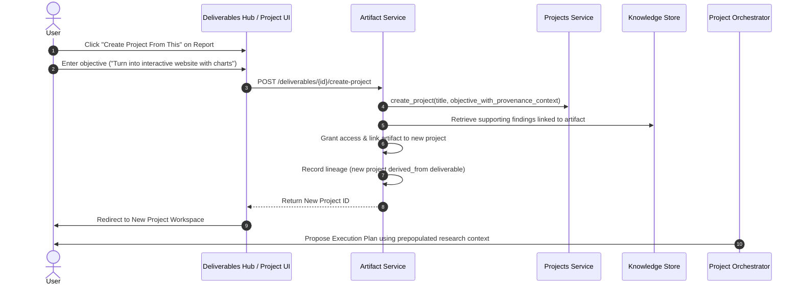

# Qwen Collective — Artifact Reuse & Provenance Lineage

## 1. Overview

In Qwen Collective, every deliverable is designed to be a durable starting point for future work. The **Reuse and Lineage Subsystem** establishes formal protocols for:
1. Re-injecting an artifact into its home project to drive follow-up stages.
2. Sharing authorized deliverables across distinct projects without cross-project data leakage.
3. Spawning new projects centered around existing deliverables ("Create Project From This").
4. Tracking a directional Directed Acyclic Graph (DAG) of revisions, derivations, citations, and analytical transformations.

---

## 2. In-Project Reuse ("Use in This Project")

When a user or autonomous orchestrator chooses to reuse an artifact within its originating project, the system opens a structured workflow rather than requiring prompt copy-pasting.

### Supported Actions
- **`analyze`**: Inspect content, compute metrics, extract distributions, or evaluate findings.
- **`revise`**: Request iterative changes or corrections based on feedback.
- **`expand`**: Broaden scope, add missing sections, or deepen investigation.
- **`summarize`**: Synthesize key takeaways, executive briefs, or bulleted summaries.
- **`convert`**: Transform file format (e.g. JSON to CSV, Markdown to HTML/PDF).
- **`custom`**: Free-form natural language directive (e.g., *"Take this report and generate a slide presentation script"*).

### Orchestrator Mechanics
1. **Input Task Definition**:
   ```json
   {
     "task_type": "artifact_reuse_analyze",
     "title": "Analyze telemetry_data.csv",
     "input_artifacts": [
       {
         "artifact_id": "art-4b8c9d0e1f2a",
         "version": 1,
         "display_name": "telemetry_data.csv",
         "role": "source_dataset"
       }
     ],
     "instructions": "Calculate mean and 99th percentile latencies."
   }
   ```
2. **Provenance Link**: Automatically registers an `artifact_lineage` record linking the source artifact to the task and any subsequent derivative outputs.

---

## 3. Cross-Project Sharing & Authorization Boundaries

To prevent unauthorized cross-project data leakage, Project B cannot read Project A's private assets by default.

### Authorization Workflow:
1. **Explicit Sharing Grant**: A user or authorized policy generates a record in `artifact_access_grants`:
   - `artifact_id`: Targeted asset.
   - `source_project_id`: Project A.
   - `target_project_id`: Project B.
   - `granted_by`: Authorized user.
   - `status`: `active`.
2. **Association Link**: An `artifact_project_links` row is created with `role = 'imported'`.
3. **Immutability of Origin**: Project B can read and cite the artifact, but cannot overwrite Project A's original file or modify its historical versions.

---

## 4. Artifact-Aware Project Creation ("Create Project From This")

The "Create Project From This" feature is a flagship capability that transforms completed research into immediate operational initiatives.

### The Problem it Solves:
Previously, building an app from a finished report required manually downloading the PDF, creating a project, uploading the file, and writing a prompt from scratch. Context was lost and provenance was broken.

### The New Native Workflow:


---

## 5. Provenance & Lineage Graph

The system tracks relationships via the `artifact_lineage` table:

```
[SOURCE DATASET (art-101)]
       │
       ├─────────────────────────────────┐
       ▼ (transforms)                    ▼ (analyzes)
[CLEANED DATASET (art-102)]       [TELEMETRY CHARTS (art-103)]
       │                                 │
       ▼ (derived_from)                  ▼ (cites)
[RESEARCH REPORT (art-104)] ◄────────────┘
       │
       ├─────────────────────────────────┐
       ▼ (revised_from)                  ▼ (summarizes)
[FINAL REPORT v2 (art-104)]       [EXECUTIVE BRIEF (art-105)]
       │
       ▼ (knowledge_extraction)
[KNOWLEDGE FINDINGS (know-501..505)]
```

### Supported Relationship Types:
- `derived_from`: Direct analytical or computational derivative.
- `revised_from`: Successive version or corrective edit.
- `summarizes`: Condensed representation of broader content.
- `transforms`: Schema or format conversion without semantic change.
- `analyzes`: Evaluative findings produced by inspecting the source.
- `compares`: Multi-artifact synthesis or benchmarking.
- `cites`: Referenced as evidential authority.
- `uses_as_input`: Consumed by a downstream pipeline or model run.
- `incorporated_into`: Merged into a composite package or publication.

### Change Impact Analysis:
When a source artifact is found to be flawed, contradicted, or superseded, the lineage graph enables an immediate audit query:
```sql
SELECT target_artifact_id, relationship_type, context_description
FROM artifact_lineage
WHERE source_artifact_id = :stale_artifact_id;
```
Downstream deliverables, tasks, and derived knowledge records can be flagged for review, preventing obsolete conclusions from quietly compromising active projects.
