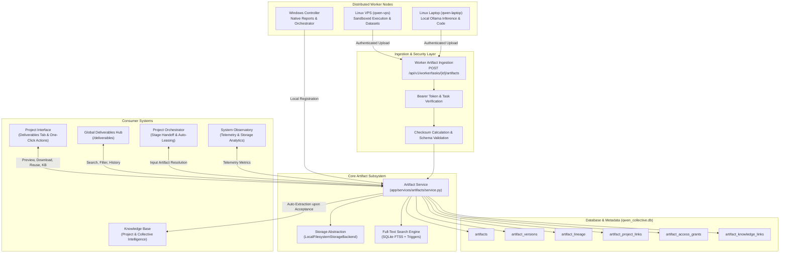

# Qwen Collective — Unified Deliverables & Artifact System Architecture

## 1. Executive Summary & Mission

The **Unified Deliverables & Artifact Management System** is a foundational architectural upgrade for Qwen Collective that transforms every output generated across the distributed cluster (Windows Controller, Linux VPS, and Linux Laptop workers) from a disposable task result into a **durable, discoverable, versioned, provenance-aware, and reusable project asset**.

### The Core Principle
> **Every deliverable is a persistent, reusable, provenance-aware asset.**

Outputs are no longer stranded in worker directories, buried in unstructured task logs, or lost when an execution run finishes. Every asset is given a canonical universal identity, stored atomically with SHA-256 cryptographic verification, tracked across an immutable lineage graph, connected to the project and collective knowledge base, and accessible via one-click user actions and structured orchestrator interfaces.

---

## 2. Artifact vs. Deliverable: Conceptual Distinction

A foundational rule of this architecture is the clean separation between an **Artifact** and a **Deliverable**:

```
+--------------------------------------------------------------------------+
|                                ARTIFACT                                  |
| Any persistent output or input associated with project activity:         |
|  - Generated source code and build packages                              |
|  - Raw, cleaned, or intermediate CSV / JSON datasets                     |
|  - Research notes, telemetry snapshots, execution logs                   |
|  - Charts, diagrams, and model-generated markdown texts                  |
|  - User-uploaded reference documents and specs                           |
+--------------------------------------------------------------------------+
                                     ▲
                                     │ (Formal designation & acceptance)
                                     ▼
+--------------------------------------------------------------------------+
|                               DELIVERABLE                                |
| A project-level milestone entity formally designated as a stage output:  |
|  - Accepted final research reports & technical whitepapers               |
|  - Completed & verified applications or deployment packages              |
|  - Approved datasets and verified benchmarks                             |
|  - Presentation decks and executive briefs                               |
|                                                                          |
| * References a managed canonical Artifact rather than storing files in   |
|   a separate, incompatible filesystem or database blob.                  |
+--------------------------------------------------------------------------+
```

A **Deliverable** references a managed canonical `Artifact` via `deliverables.primary_artifact_id`. While an intermediate task can generate dozens of artifacts, only those formally vetted and accepted against project success criteria become accepted deliverables.

---

## 3. High-Level Component Architecture



---

## 4. Universal Artifact Identity & Metadata Schema

Every artifact is assigned a globally unique, immutable identifier formatted as `art-<uuid4_hex[:12]>`.

### Relational Schema (Migration 13)

| Table | Primary Purpose | Key Fields |
|---|---|---|
| `artifacts` | Canonical identity and current metadata | `id`, `project_id`, `display_name`, `artifact_type`, `mime_type`, `size_bytes`, `checksum_sha256`, `storage_backend`, `storage_key`, `status`, `validation_status`, `knowledge_status`, `visibility` |
| `artifact_versions` | Immutable historical revisions | `id`, `artifact_id`, `version_number`, `parent_version_id`, `storage_key`, `checksum_sha256`, `size_bytes`, `change_description`, `created_at`, `created_by` |
| `artifact_lineage` | Provenance DAG relationships | `id`, `source_artifact_id`, `target_artifact_id`, `relationship_type`, `source_version`, `target_version`, `context_description` |
| `artifact_project_links` | Multi-project associations & roles | `id`, `artifact_id`, `project_id`, `role` (`primary_output`, `imported`, `referenced`), `added_at` |
| `artifact_task_links` | Execution task linkage | `id`, `artifact_id`, `task_id`, `direction` (`input`, `output`), `role` |
| `artifact_access_grants` | Explicit cross-project security grants | `id`, `artifact_id`, `source_project_id`, `target_project_id`, `granted_by`, `status` |
| `artifact_knowledge_links` | Derived knowledge provenance | `id`, `artifact_id`, `artifact_version_number`, `knowledge_record_id`, `extraction_method`, `extracted_claim` |
| `artifacts_fts` | SQLite FTS5 Full-Text Search index | Indexed on `display_name`, `description`, `artifact_type`, `extracted_text` with automatic synchronization triggers |

---

## 5. Artifact Lifecycle State Machine

Artifacts follow an explicit, verified progression:

```
[generating] ──► [uploading] ──► [validating] ──► [available] ──► [needs_review] ──► [accepted]
       │               │               │
       ▼               ▼               ▼
   [failed]        [failed]        [failed]
```

- **`generating`**: The worker task is executing and producing output.
- **`uploading`**: Output transmission is underway over authenticated HTTP multipart.
- **`validating`**: Payload integrity verification, SHA-256 calculation, and mime-type inspection.
- **`available`**: Stored in durable storage and accessible for download or preview.
- **`needs_review`**: Linked to a submitted Deliverable awaiting human review.
- **`accepted`**: Deliverable review passed; triggers automatic knowledge extraction and downstream unblocking.
- **`failed`**: Checksum mismatch, size limit exceeded, or validation error.
- **`missing`**: Metadata exists but physical file cannot be resolved.
- **`archived`**: Retained for compliance/audit but hidden from active search.

---

## 6. Access Control & Project Isolation

1. **Project-Scoped Default**: An artifact created in Project A is private to Project A by default (`visibility = 'project'`).
2. **Explicit Cross-Project Sharing**: For Project B to consume an artifact from Project A, an explicit grant must exist in `artifact_access_grants`, or the artifact must be designated `visibility = 'collective'`.
3. **Task-Scoped Worker Leases**: Workers only receive download authorization for artifacts explicitly declared in the task's `input_artifacts` list. Arbitrary file enumeration is denied.
