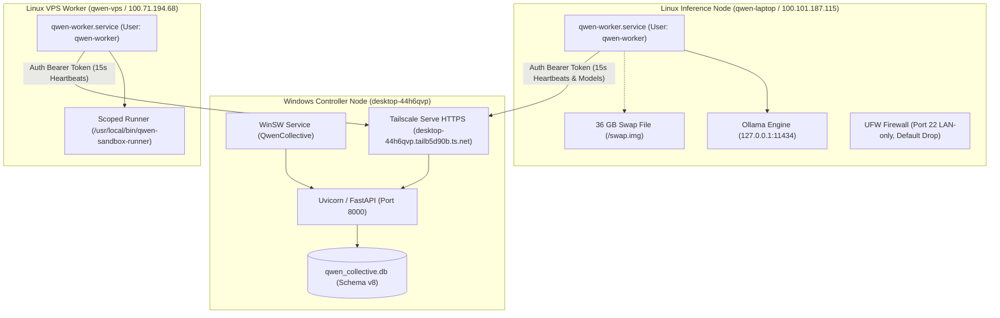

# Qwen Collective — Current System State & Infrastructure Topology

**As of**: 2026-10-15T03:40:00-07:00  
**Repository Branch**: `feature/laptop-node-and-model-discovery`  
**Control Plane**: Windows Production Controller (Tailscale HTTPS & Port 8000)

---

## 1. Node Inventory & Operational Status

The cluster currently consists of **4 distinct nodes** interconnected via an encrypted Tailscale WireGuard mesh (`tailb5d90b.ts.net`) and local subnet:

| Node ID | Friendly Name | Host Platform | Primary IP / Tailscale IP | Role | Status | Memory / Swap | Primary Capabilities |
| :--- | :--- | :--- | :--- | :--- | :--- | :--- | :--- |
| **`controller-local`** | Windows Controller | Windows 10 Pro (x86_64) | LAN `192.168.4.69` Tailscale: `desktop-44h6qvp` | `controller` | **ONLINE** | 24.6 GB RAM | FastApi Control Server, SQLite DB, WinSW Service, Tailscale HTTPS |
| **`qwen-laptop`** | Qwen Laptop | Ubuntu 24.04 (i3-6100U) | LAN `192.168.4.48` Tailscale: `100.101.187.115` | `inference_node` `distributed_worker` | **ONLINE** | 3.8 GB RAM **36.0 GB Swap** | Ollama v0.40.4 (`qwen2.5:1.5b`, `llama3.2:1b`), sandboxed execution |
| **`qwen-vps`** | Qwen VPS | Ubuntu 24.04 (Linode 1 vCPU) | Tailscale: `100.71.194.68` Public: `172.233.140.74` | `vps_worker` | **ONLINE** | 961 MB RAM | Remote sandbox execution daemon (`qwen-worker.service`), systemd runner |
| **`node-d35568f5`** | Linode | Linux (Legacy record) | Public: `172.233.140.74` | `compute_worker` | **OFFLINE** | N/A | Historical node superseded by authenticated `qwen-vps` worker daemon |

---

## 2. Model Inference & Capabilities

| Node | Model Name | Format / Quantization | Parameter Count | Context Window | Verified Generation Speed | Status |
| :--- | :--- | :--- | :--- | :--- | :--- | :--- |
| `qwen-laptop` | **`qwen2.5:1.5b`** | GGUF `Q4_K_M` | 1.54B | 32,768 tokens | **10.43 tokens/sec** | **Ready** |
| `qwen-laptop` | **`llama3.2:1b`** | GGUF `Q8_0` | 1.24B | 131,072 tokens | **10.88 tokens/sec** | **Ready** |

---

## 3. Network Architecture & Security Boundaries

### Key Security Isolations
1. **Isolated Tokens**: `qwen-laptop` and `qwen-vps` maintain independent, cryptographically separate bearer tokens persisted at `/opt/qwen-collective/data/worker_token.json` (`0600`).
2. **Loopback Model Binding**: Ollama on `qwen-laptop` is bound exclusively to `127.0.0.1:11434`. Public access is blocked by policy and UFW.
3. **LAN-Restricted SSH**: `qwen-laptop` allows inbound SSH only from `192.168.4.0/22`. All other interfaces drop inbound connection attempts.
4. **Sandboxed Worker Daemons**: Both `qwen-laptop` and `qwen-vps` run under unprivileged dedicated user `qwen-worker` with `ProtectSystem=full`, `ProtectHome=true`, and `PrivateTmp=true`.

---

## 4. Key Configuration Files on Nodes

### Laptop (`qwen-laptop`)
- `/etc/qwen-collective/worker.env`: Environment configuration (`QC_CONTROLLER_URL`, `QC_WORKER_ID=qwen-laptop`)
- `/opt/qwen-collective/data/worker_token.json`: Secure persisted bearer token (`0600`)
- `/etc/systemd/system/qwen-worker.service`: Systemd service unit (enabled & running)
- `/etc/sysctl.d/99-qwen-performance.conf`: `vm.swappiness=15`, `vm.vfs_cache_pressure=50`
- `/swap.img`: 36.0 GiB pre-allocated swap file
- `/etc/sudoers.d/qwen-worker`: Restricted privilege for `/usr/local/bin/qwen-sandbox-runner` only

### Controller (`desktop-44h6qvp`)
- `C:\Users\Matt C\.qwen-collective\data\qwen_collective.db`: SQLite database (Schema Version 8)
- `C:\Users\Matt C\.qwen-collective\qwen-collective.env`: Master server configuration & admin password
- `C:\Users\Matt C\.gemini\antigravity-ide\scratch\qwen-collective\service\qwen-collective-service.xml`: WinSW service definition

---

## 5. Web Dashboard Endpoints

- **System Overview**: [`http://127.0.0.1:8000/`](http://127.0.0.1:8000/) — Shows 3 registered machines (2 online, 1 offline) and active Qwen 2.5 1.5B inference engine.
- **Machine Registry**: [`http://127.0.0.1:8000/machines`](http://127.0.0.1:8000/machines) — Live status of `qwen-laptop`, `qwen-vps`, and `node-d35568f5`.
- **Inference & Models**: [`http://127.0.0.1:8000/inference`](http://127.0.0.1:8000/inference) — Configured inference backends (`qwen2.5:1.5b`, `llama3.2:1b`).
- **Infrastructure Inventory**: [`http://127.0.0.1:8000/infrastructure?tab=workers`](http://127.0.0.1:8000/infrastructure?tab=workers) — Comprehensive topological view with runtime badges, model chips, and hardware utilization.
