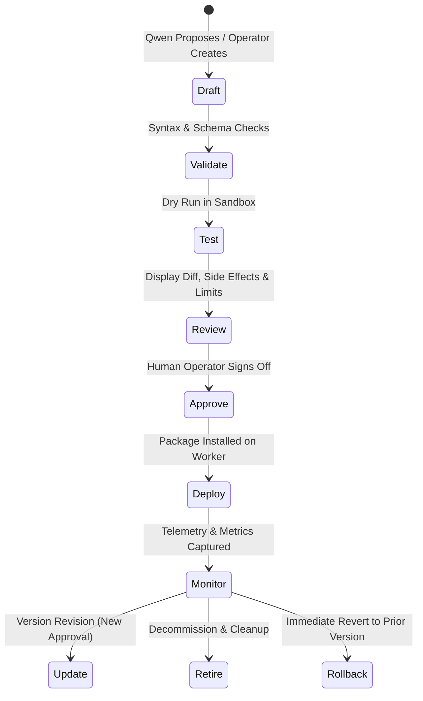

# Qwen Collective — Deployment Lifecycle Specification

## 1. Deployments vs. Tasks

In Qwen Collective, a **Deployment** is distinct from an individual **Task**:
* **Task:** A one-time bounded work unit (e.g. "Run network connectivity diagnostics").
* **Deployment:** An approved, versioned executable package installed on a worker node that may execute continuously or repeatedly over time (e.g. "Hourly CVE vulnerability scraper systemd timer"). One deployment generates many execution records.

---

## 2. The 8-Stage Deployment Lifecycle

1. **Draft:** Specification defined (source code, runtime, schedules, required secrets, permissions).
2. **Validate:** Automated linting, import resolution, and capability compatibility verification.
3. **Test:** Side-effect-free execution test against sandbox parameters.
4. **Review:** Operator inspection showing external endpoints contacted, file system paths, resource limits, and schedule.
5. **Approve:** Human authorization records immutable approval decision.
6. **Deploy:** Worker installs package, configures systemd unit/timer if applicable.
7. **Monitor:** Real-time collection of execution records, resource consumption, and uptime.
8. **Update / Retire / Rollback:** Version bumps require new reviews. Any deployment can be rolled back to its predecessor version immediately.

---

## 3. Immutability & Reconciliation

* Executable artifacts associated with a deployment version are hashed with SHA-256. Content cannot be silently altered.
* The controller periodically reconciles declared deployments against worker state to detect drift (e.g. an unexpected local edit or an inactive systemd service).

---

## 4. Status

* **Status:** Defined for architectural awareness in Milestone 1; active deployment management implemented in Milestone 4.
