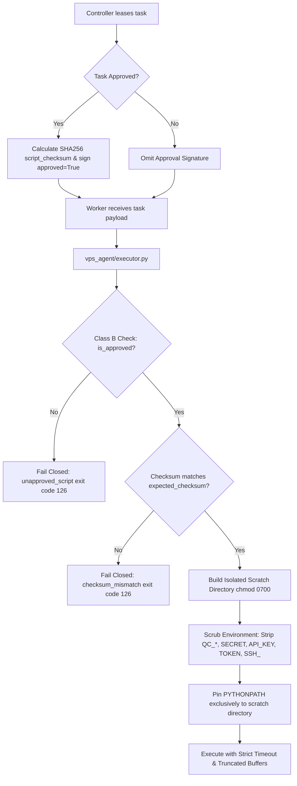

# Class B Python Execution Isolation Validation
**Antigravity — Qwen Collective**  
**Component:** `vps_agent/executor.py`, `app/services/worker.py`  
**Status:** VALIDATED & PASSING

---

## 1. Problem Statement
The initial agent execution model allowed Python scripts to execute in a temporary directory with execution timeouts and environment-variable filtering. However:
1. A temporary directory alone is not a security sandbox.
2. A task payload containing arbitrary Python source code could execute as a Class B task without an explicit approval record or cryptographic checksum.
3. Subprocesses inherited the Python module search path (`sys.path`), potentially allowing scripts to import internal agent modules (`vps_agent`), access worker credentials, or inspect host state.
4. Class C experimental/untrusted code required verifiable isolation before execution.

---

## 2. Implemented Architecture & Defense in Depth

### Defense Safeguards:
1. **Registered Approval Requirement:**
   - Any script executed under `task_type = 'python_execution'` MUST have `approved: True` or `is_approved: True` or an `approved_script_id`.
   - The controller only attaches this approval when leasing tasks that either do not require human approval or have been explicitly transitioned to `approved` / `queued` through the administrative approval gate.
   - Arbitrary unapproved code payloads fail closed immediately with `error_category = 'unapproved_script'` and exit code 126.
2. **Immutable Checksum Validation:**
   - The controller computes `hashlib.sha256(script.encode('utf-8')).hexdigest()`.
   - The executor independently calculates the SHA256 checksum of the script to be run.
   - If `actual_checksum != expected_checksum`, execution halts immediately with `error_category = 'checksum_mismatch'` and exit code 126.
3. **Environment Variable Cleansing:**
   - Scrubbing removes `QC_*`, `API_KEY`, `TOKEN`, `SECRET`, `PASSWORD`, `DATABASE_`, `SSH_`, and `AWS_` variables.
   - Subprocesses have no visibility into the worker's authentication token or host secrets.
4. **Module Import Isolation (PYTHONPATH):**
   - The child process environment sets `PYTHONPATH` exclusively to the disposable `work_dir`.
   - Attempts by child scripts to `import vps_agent` or controller packages fail with `ImportError`.
5. **Filesystem Boundary:**
   - On POSIX systems, `work_dir.chmod(0o700)` restricts read/write permissions strictly to the executing user account.
6. **Class C Fail-Closed Runtime Guard:**
   - Any unreviewed experimental code (`task_type = 'experimental_code'`) checks for container runtime availability (`_check_container_isolation_available()`).
   - If unavailable, execution immediately fails closed with `error_category = 'isolation_unavailable'`.

---

## 3. Automated Test Evidence

All isolation safeguards are verified in `tests/test_vps_agent.py`:

| Test Name | Verification Focus | Result |
| :--- | :--- | :--- |
| `test_executor_python_script_execution` | Approved script with valid payload executes cleanly | **PASS** |
| `test_executor_unapproved_script_fails_closed` | Arbitrary unapproved script rejected (code 126, `unapproved_script`) | **PASS** |
| `test_executor_checksum_validation_success` | Valid SHA256 checksum matches and executes | **PASS** |
| `test_executor_checksum_mismatch_fails_closed` | Tampered script with mismatched checksum rejected (code 126, `checksum_mismatch`) | **PASS** |
| `test_executor_environment_sanitization_strips_controller_secrets` | Subprocess cannot see `QC_SECRET_KEY`, `QC_DATABASE_URL`, or `TOKEN_API_SECRET` | **PASS** |
| `test_executor_pythonpath_isolation_blocks_agent_imports` | `import vps_agent` inside script fails with `ImportError` | **PASS** |
| `test_executor_timeout_limit` | Process killed after timeout limit expires (code 124, `timeout`) | **PASS** |
| `test_executor_unsupported_operation_rejection` | Arbitrary binaries rejected (`unsupported_operation`) | **PASS** |
| `test_executor_class_c_fails_closed_without_container_runtime` | Experimental code fails closed without container runtime (`isolation_unavailable`) | **PASS** |

---

## 4. Residual Risk & Operational Boundary
- **Same-UID Limitation on Bare Host:** When Class B scripts execute directly via the Python interpreter on the host, they run under the same OS user as the VPS agent service unless wrapped in a dedicated restricted service user (e.g., `nobody` or `qwen-worker`). For production cutover, the VPS worker service should run under a dedicated unprivileged service account without `sudo` privileges.
- **Class C Tasks:** AI-generated experimental programs remain locked until container isolation is provisioned.
