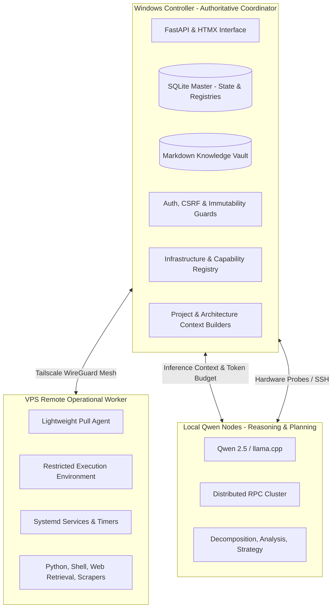
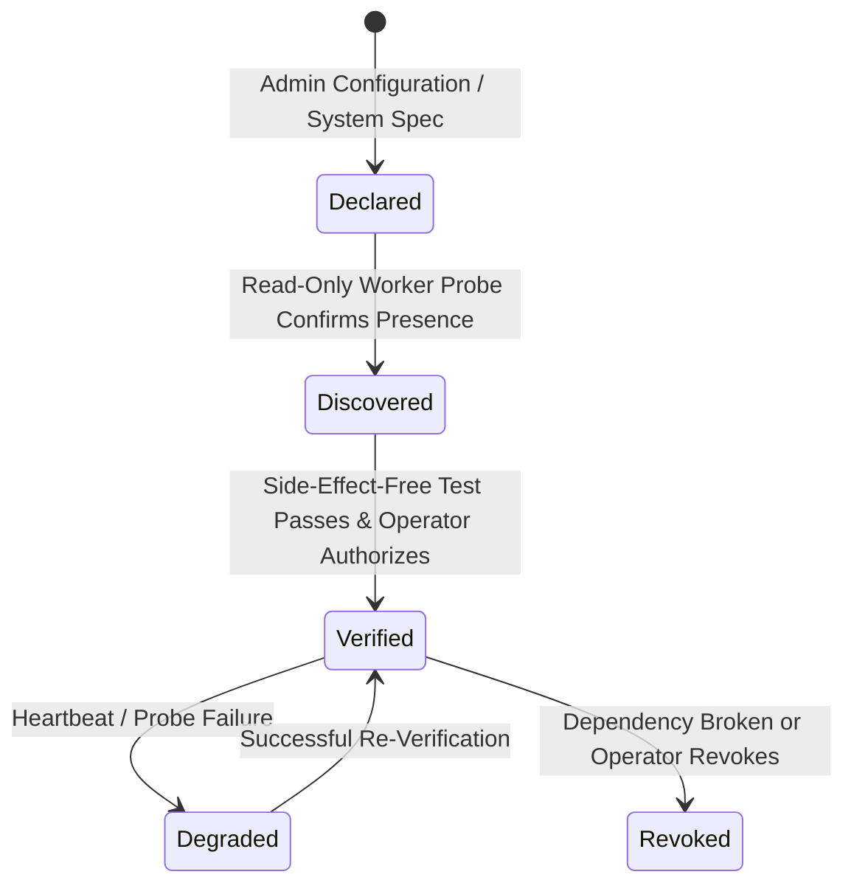

# Qwen Collective — Infrastructure Architecture

## 1. System Mission & Operating Philosophy

Qwen Collective is a distributed, goal-directed AI coordination and execution platform. The system operates under the principle that the AI models must **understand their own infrastructure**: what resources, software, tools, and execution environments are available, what those components are verified capable of doing, and how to safely orchestrate them to accomplish approved project objectives.

---

## 2. Component Roles & Authoritative Boundaries

### 2.1 Windows Controller (Authoritative Coordinator)
* **Operating Environment:** Windows 10/11 running as an unattended Windows Service (`QwenCollective` via WinSW wrapper) on `127.0.0.1:8000`.
* **Core Responsibilities:**
  * Authoritative state store for all Projects, Paths, Stages, Tasks, Deliverables, Metrics, and Knowledge.
  * Central Infrastructure Registry and Capability Registry.
  * Deployment authorization, approval workflow gates, and immutable decision logging.
  * Context Packet generation (Project Context Packets and Architecture Context Packets).
  * Central user interface (FastAPI, Jinja2, HTMX) accessible via localhost and Tailscale Serve.
* **Security & Invariants:**
  * Authoritative decisions and approvals occur only on the controller.
  * Triggers and append-only tables prevent retroactive tampering.

### 2.2 Local Qwen Nodes (Intelligence & Reasoning)
* **Operating Environment:** Windows workstation with NVIDIA GPU and Linux compute laptops networked over Tailscale and coordinated via `llama.cpp` RPC.
* **Core Responsibilities:**
  * Reasoning, strategic path generation, task decomposition, and code drafting.
  * Evaluation of empirical metrics, forecast interpretation, and retrospective synthesis.
* **Invariants:**
  * Qwen instances must **never memorize static assumptions** about installed packages, network addresses, or node capacities.
  * All environmental knowledge is injected dynamically via token-budgeted, timestamped **Architecture Context Packets**.

### 2.3 Remote VPS (Execution & Operational Environment)
* **Operating Environment:** Cloud Linux virtual private server (e.g. Debian/Ubuntu) with fixed public egress and Tailscale mesh IP.
* **Core Responsibilities:**
  * Network-accessible execution of approved scripts, programs, and persistent services.
  * Unattended execution of recurring jobs (systemd timers) that do not require continuous AI inference.
  * Web research, scraping, browser automation (Playwright/Chromium), document extraction, and API integrations.
  * Result buffering and synchronization back to the Windows controller.
* **Invariants:**
  * The VPS is an operational execution target, **not an unmanaged general-purpose root server**.
  * All programs run under dedicated unprivileged system identities with resource limits and execution sandboxes.

---

## 3. Communication Architecture & Network Topologies

1. **Private Mesh Transport:**
   * All inter-node communications flow exclusively over encrypted **Tailscale WireGuard** mesh interfaces (100.x.y.z addresses) or local loopback (127.0.0.1).
   * No worker management ports are exposed to the public internet by default.
2. **Outbound Pull-Based Worker Protocol:**
   * The remote worker connects outbound to the controller's worker API over Tailscale.
   * Workers authenticate using dedicated, high-entropy bearer tokens (`QC_AUTH_TOKEN`, minimum 32 chars).
   * Workers lease authorized tasks, report heartbeat status, buffer execution output, and deliver verifiable deliverables.

---

## 4. Capability Triad: Declared vs. Discovered vs. Verified

1. **Declared:** What configuration specifies the node should support (e.g. "VPS supports Python 3.12 script execution").
2. **Discovered:** What read-only inspection actually finds installed and reachable on the hardware.
3. **Verified:** What the controller has explicitly tested with side-effect-free probes and authorized for operational use.

An installed runtime or open port is **never assumed operational** until verified.

---

## 5. Architectural Lifecycle Status Matrix

| Component / Layer | Status | Implementation Details |
| :--- | :--- | :--- |
| **Windows Controller Service** | **Operational in Production** | WinSW service wrapper, port 8000, Tailscale Serve HTTPS |
| **Database & Project Intelligence** | **Operational in Production** | SQLite `user_version = 5`, Milestones 1–5 deployed |
| **Infrastructure Registry Schema** | **Implemented (Milestone 1)** | `infrastructure_nodes`, `infrastructure_capabilities`, `infrastructure_reconciliations` |
| **Capability Discovery & Verification** | **Implemented (Milestone 1)** | Read-only local & remote probes, side-effect-free test suite |
| **Architecture Context Packet** | **Implemented (Milestone 1)** | Token-budgeted context builder with priority pruning |
| **Read-Only Infrastructure Dashboard** | **Implemented (Milestone 1)** | `/infrastructure` views (overview, workers, capabilities, context inspector) |
| **VPS Pull-Based Agent** | **Planned (Milestone 2)** | Outbound worker loop, task leasing, heartbeat protocol |
| **Sandboxed VPS Execution** | **Planned (Milestone 3)** | Unprivileged worker runtime, execution timeouts, artifact capture |
| **Systemd Deployment Engine** | **Planned (Milestone 4)** | Versioned service & timer management, status reconciliation |
| **Project & Knowledge Linkage** | **Planned (Milestone 5)** | Automated deliverable outputs, operational evidence capture |
| **AI Autonomous Operator** | **Planned (Milestone 6)** | Qwen infrastructure-aware deployment proposal generator |
