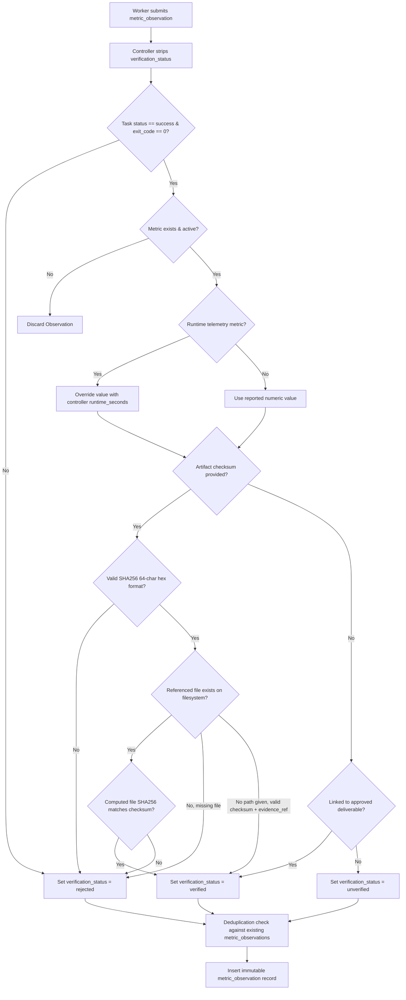

# Metric Verification & Evidence Integrity Validation
**Antigravity — Qwen Collective**  
**Component:** `app/services/worker.py`, `app/services/metrics.py`, `app/services/context_packet.py`  
**Status:** VALIDATED & PASSING

---

## 1. Problem Statement
In previous iterations, when a worker node completed a task, it could embed a `metric_observation` payload in its submission. The controller previously inserted this observation with `verification_status = 'verified'` directly in SQL, allowing an untrusted worker to self-verify arbitrary metric claims without independent evidence verification.

---

## 2. Separation of Concerns: Reported vs Validated vs Accepted

The controller now enforces strict separation between:
1. **Reported Measurements:** Numeric values submitted by an execution worker (untrusted claims).
2. **Validated Measurements:** Values checked against independent rules (e.g. SHA256 checksum match against an artifact on the filesystem, or controller-measured execution runtime).
3. **Accepted Observations:** Authoritative metrics recorded in `metric_observations` with appropriate `verification_status` (`verified`, `unverified`, or `rejected`).

### Verification Safeguards:
1. **No Worker Self-Verification:**
   - Any worker-submitted `verification_status` is discarded. The controller alone assigns this field.
2. **Authoritative Runtime Telemetry:**
   - If the metric measures duration (`metric_type == 'duration'`) or is marked as runtime telemetry, the controller overrides the worker-reported value with its own recorded `runtime_seconds`.
3. **Cryptographic Checksum Verification:**
   - If `artifact_checksum` is provided, it must be a valid 64-character hexadecimal SHA256 hash.
   - If an artifact file path is specified, the controller reads the file and computes `hashlib.sha256(data).hexdigest()`.
   - If the file is missing or the hash fails to match, the observation is marked `verification_status = 'rejected'` with detailed diagnostic notes.
4. **Deliverable Linkage:**
   - If linked to an approved completed task deliverable or valid evidence reference, the observation qualifies as `verified`.
   - If evidence is missing, the observation is marked `unverified`.
5. **Deduplication:**
   - Duplicate observations for the same metric and evidence reference are deduplicated, preventing inflated observation counts.
6. **Project Context Packet Visible Distinctions:**
   - In `app/services/context_packet.py`, verified metrics render as:
     `Actual: {val} (verified)`
   - Unverified observations render visibly as:
     `Reported: {val} (unverified)`
   - This ensures AI models (Qwen) and human operators never mistake an unconfirmed claim for ground truth.
7. **Forecast Integrity:**
   - Transparent forecasting algorithms (`calculate_linear_trend_forecast`, rolling average, etc.) support `verified_only=True`, ensuring unverified claims or fraudulent outliers do not corrupt trajectory predictions.

---

## 3. Automated Test Evidence

Verified in `tests/test_metric_integrity.py`:

| Test Name | Test Scenario | Outcome |
| :--- | :--- | :--- |
| `test_worker_cannot_self_verify_arbitrary_metric` | Worker submits `verification_status='verified'`; controller forces `unverified` | **PASS** |
| `test_metric_observation_invalid_checksum_rejected` | Malformed checksum string rejected by controller as `rejected` | **PASS** |
| `test_metric_observation_checksum_mismatch_on_file_rejected` | Tampered file content failing SHA256 rejected as `rejected` | **PASS** |
| `test_metric_observation_valid_evidence_and_checksum_verified` | Valid artifact file with matching SHA256 accepted as `verified` | **PASS** |
| `test_metric_observation_deduplication` | Duplicate observations for same evidence reference deduplicated | **PASS** |
| `test_context_packet_distinguishes_verified_vs_unverified` | Context packet displays `Reported: ... (unverified)` vs `Actual: ... (verified)` | **PASS** |
| `test_forecast_calculation_ignores_unverified_observations` | Linear trend forecasting ignores unverified outliers when `verified_only=True` | **PASS** |

---

## 4. Summary
Untrusted worker assertions can no longer become authoritative metrics without passing cryptographic evidence verification or deliverable review.
