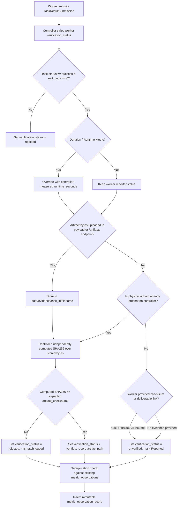

# Metric Verification & Evidence Integrity Validation
**Antigravity — Qwen Collective**  
**Component:** `app/services/worker.py`, `app/services/metrics.py`, `app/routes/worker.py`, `app/services/context_packet.py`  
**Branch:** `fix/vps-production-acceptance`  
**Status:** VALIDATED & PASSING (Shortcuts Eliminated, Real Artifact Hashing Enforced)

---

## 1. Problem Statement & Residual Flaws Eliminated

The previous metric validation implementation contained two critical shortcuts that permitted worker claims to be classified as `verified` without independently verifiable physical evidence:

- **Shortcut A (Format-Only Verification):** A worker could provide a valid 64-character hexadecimal SHA256 string and an `evidence_reference`. If no local file path was found on the controller, the system previously accepted the observation as `verified` based solely on the checksum's syntactic validity.
- **Shortcut B (Deliverable Association Shortcut):** If an observation was linked to an approved task or deliverable ID, the system treated the observation as `verified` even if no supporting artifact was transmitted or stored.

Neither shortcut proved that the reported measurement was authentic or supported by real data.

---

## 2. Separation of Four Metric Lifecycle States

To ensure authoritative ground truth while preserving the existing database schema (`CHECK (verification_status IN ('unverified','verified','rejected'))`), the controller explicitly distinguishes four conceptual states:

```
[ Worker Submission ]
         │
         ▼
   1. REPORTED ──────► Worker claims a numeric value / checksum. Stored as `unverified` with diagnostic note.
         │
         ▼
   2. VALIDATED ─────► Controller receives physical bytes, verifies file size/type, matches SHA256.
         │
         ▼
   3. VERIFIED ──────► Artifact stored in controlled evidence directory; controller marks `verification_status = 'verified'`.
         │
         ▼
   4. ACCEPTED ──────► Reviewer approves observation for project milestone; recorded via immutable correction `supersedes_id`.
```

### State Mapping:
- **`reported`**: The worker submitted an unconfirmed claim. (DB: `unverified`)
- **`validated`**: Independent physical byte verification succeeded. (DB: `verified`)
- **`verified`**: The measurement is certified by controller evidence or trusted controller telemetry. (DB: `verified`)
- **`accepted`**: The observation has undergone administrative/project acceptance. (DB: `verified` with superseding correction)
- **`rejected`**: The checksum mismatched, file was corrupted, or execution failed. (DB: `rejected`)

---

## 3. Independent Controller Evidence Verification Workflow



### Enforced Rules:
1. **Zero Self-Verification:** Worker-submitted `verification_status` fields are always discarded.
2. **Physical Byte Requirement:** A checksum without actual retrievable bytes on the controller is marked `unverified` with the note:  
   `"[Reported: Checksum provided without retrievable artifact file on controller]"`.
3. **Deliverable Linkage Without Evidence:** An observation linked to a deliverable without retrievable physical evidence is marked `unverified` with the note:  
   `"[Reported: Linked to deliverable ..., awaiting independent artifact validation]"`.
4. **Controlled Storage:** All worker artifacts are deposited in `data/evidence/task_{task_id}/{filename}` with directory traversal protection.
5. **Independent Hashing:** The controller reads the physical file from disk in 64 KB chunks and computes `hashlib.sha256()`. If the hash differs by even one bit, the observation is marked `rejected`.
6. **Immutable Ledger Compliance:** SQLite trigger `trg_observations_no_update` forbids in-place `UPDATE`. Observation state changes (such as administrative acceptance) invoke `accept_observation()`, which calls `record_observation_correction()` to append an immutable auditable record with `supersedes_id` and `correction_reason`.

---

## 4. Automated Test Evidence

All 11 tests pass in `tests/test_metric_integrity.py`:

| Test Name | Test Scenario | Verified Outcome |
| :--- | :--- | :--- |
| `test_worker_cannot_self_verify_arbitrary_metric` | Worker submits `verification_status='verified'`; controller forces `unverified` | **PASS** |
| `test_metric_observation_invalid_checksum_rejected` | Malformed non-hex checksum string rejected as `rejected` | **PASS** |
| `test_metric_observation_checksum_mismatch_on_file_rejected` | Corrupted artifact file failing SHA256 marked `rejected` | **PASS** |
| `test_metric_observation_valid_evidence_and_checksum_verified` | Physical file with matching SHA256 verified | **PASS** |
| `test_metric_observation_deduplication` | Duplicate observations for same evidence reference deduplicated | **PASS** |
| `test_context_packet_distinguishes_verified_vs_unverified` | Context packet displays `Reported: ... (unverified)` vs `Actual: ... (verified)` | **PASS** |
| `test_forecast_calculation_ignores_unverified_observations` | Linear trend forecasting ignores unverified outliers when `verified_only=True` | **PASS** |
| `test_shortcut_a_eliminated_checksum_without_file_remains_unverified` | Checksum string without physical artifact file is NOT verified (`unverified`) | **PASS** |
| `test_shortcut_b_eliminated_deliverable_link_without_file_remains_unverified` | Deliverable link without physical artifact file is NOT verified (`unverified`) | **PASS** |
| `test_artifact_upload_and_verification_lifecycle` | Real artifact upload via base64, independent controller hashing, marks `verified` | **PASS** |
| `test_metric_lifecycle_states_and_acceptance` | Lifecycle states `reported`, `validated`, `verified`, `accepted` with immutable supersedes record | **PASS** |

---

## 5. Forecasting & Project Context Packet Integrity

- **Project Context Packet:**
  - Verified observations render as: `Actual: {val} (verified)`
  - Unverified observations render as: `Reported: {val} (unverified)`
- **Forecasting Engines:**
  - Trend forecasting defaults to `verified_only=True`.
  - Unverified worker claims are completely excluded from actual project trajectory calculations unless explicitly opted-in for speculative simulations.
