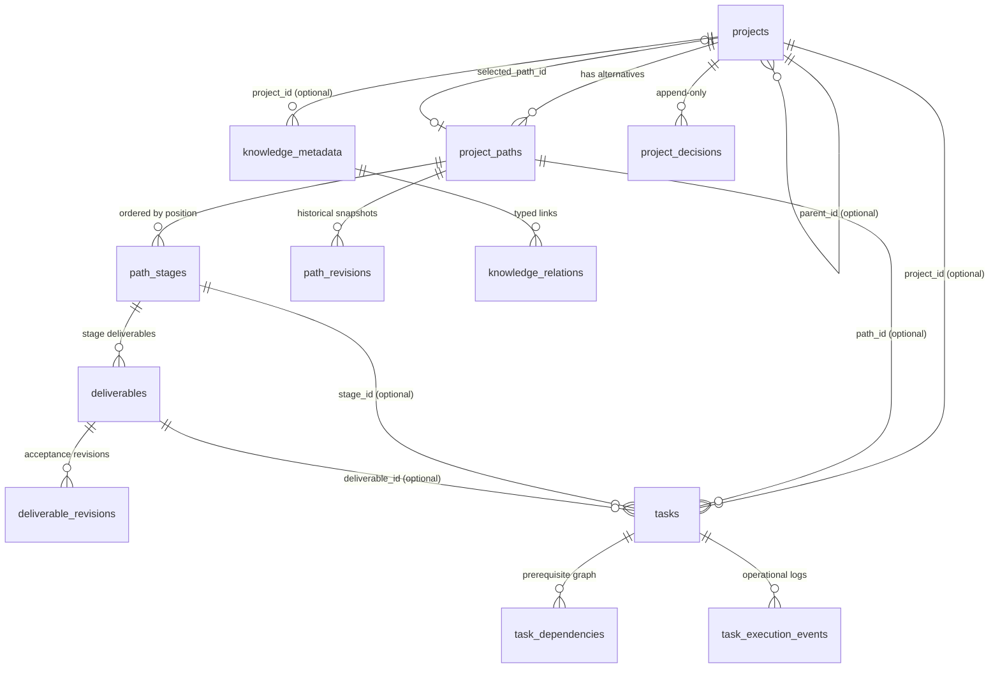

# Project Data Model (Milestones 1 & 2, schema version 2)

This describes the schema that **exists** on `feature/project-intelligence`. Source of truth:
[`app/migrations.py`](app/migrations.py). Business rules: [`app/services/projects.py`](app/services/projects.py),
[`app/services/tasks.py`](app/services/tasks.py), [`app/services/deliverables.py`](app/services/deliverables.py),
[`app/services/knowledge_meta.py`](app/services/knowledge_meta.py).

## Schema versioning

| Version | Meaning |
| :--- | :--- |
| 0 | Baseline: the tables that existed before this work, created by `create_baseline_schema()` (DDL unchanged). |
| 1 | Migration 1: Project intelligence foundation (projects, paths, stages, knowledge_metadata, knowledge_relations, project_decisions). |
| 2 | Migration 2: Execution and evidence (deliverables, deliverable_revisions, task_dependencies, task_execution_events, path_revisions, collective knowledge). |

* The version lives in `PRAGMA user_version`.
* `init_db()` runs on every start. It (1) creates the baseline tables if they're missing, (2) takes a `sqlite3.backup()` snapshot when an **existing** DB is behind, named `qwen_collective.pre-migration-v{cur}-to-v{target}-{UTC}.db` and stored next to the DB, then (3) applies pending migrations sequentially.
* Each migration runs in one `BEGIN IMMEDIATE … COMMIT` together with the version bump and a `PRAGMA foreign_key_check`. Any failure rolls the whole migration back.
* Existing tables receive non-destructive ALTER statements or safe table recreations (`project_decisions`).
* Verified on production copy with clean foreign key and integrity checks.

## Entities

### `projects`
| Column | Notes |
| :--- | :--- |
| `id` | `prj-<uuid hex>` |
| `name` | 1–200 chars, unique (case-insensitive) |
| `description`, `objective`, `scope`, `constraints_text`, `success_criteria` | Free text, at most 20,000 chars (enforced in the service) |
| `priority` | `low · medium · high · critical` |
| `status` | `draft · planning · active · paused · completed · cancelled · archived` |
| `parent_id` | Optional FK → `projects`. Can't be self (CHECK). Cycles are rejected and depth is capped at 3 (service). |
| `owner` | Username of the creator |
| `selected_path_id` | Optional FK → `project_paths`. A trigger requires the Path to belong to the same project. |
| `knowledge_dir` | Vault folder `projects/<slug>-<last 8 of id>`, unique |
| `start_date`, `target_date`, `completed_date`, `review_date` | ISO dates. `start_date` is set the first time the project becomes active. `completed_date` is set on completion. |
| `created_at`, `updated_at`, `last_activity_at` | UTC ISO timestamps |

**Project status transitions** (service-enforced; every change is recorded as a decision):

| From | Allowed to |
| :--- | :--- |
| draft | planning, active, cancelled, archived |
| planning | draft, active, paused, cancelled |
| active | paused, completed, cancelled |
| paused | active, planning, cancelled |
| completed / cancelled | archived |
| archived | (none) |

### `project_paths`
Contains strategy fields: `rationale` (**required**), `description`, `assumptions`, `constraints_text`, `dependencies`, `resource_requirements`, `risks`, `estimated_cost` (≥ 0), `estimated_effort_hours` (≥ 0), `expected_outcome`, `expected_completion_date`, `forecast_confidence` (0–1). Path names are unique within a project.

| From | Allowed to |
| :--- | :--- |
| proposed | under_review, approved, rejected |
| under_review | proposed, approved, rejected |
| approved | rejected, superseded, **active (via Select only)** |
| active | paused, completed |
| paused | superseded, **active (via Select only)** |
| superseded / completed / rejected | (terminal) |

* **Only one active Path per project.** Enforced by the partial unique index `ux_one_active_path_per_project`, not just in code.
* `select_path()` is the only way a Path becomes `active`. It requires an approved or paused Path and a reason. It sets the previous active, approved, or paused selection to `superseded`, updates `selected_path_id`, and appends a `path_selection` decision recording from, to, reason, user, and time.
* Every other status change also requires a reason and is recorded as a `path_status_change` decision.
* **Estimates freeze once a Path leaves `proposed`/`under_review`.** Superseded Paths are never deleted, so historical estimates stay visible for comparison.

### `path_stages` (extended in Milestone 2)
`position` is unique per Path. Other fields: `name`, `objective`, `description`, `prerequisites`, `expected_outputs`, `completion_criteria`, `estimated_effort_hours`, `actual_effort_hours`, `status`, and timestamps.

* **Stage completion gates (`evaluate_stage_gate`).** Evaluated deterministically:
  1. All tasks belonging to the stage must be in `completed` status.
  2. All deliverables belonging to the stage must be in `accepted` status.
  3. The stage must have verifiable work (at least one completed task, accepted deliverable, or linked verified evidence).
* **Stage advancement (`advance_stage`).** Transitions stage to `completed` upon satisfying the gate, records a `stage_advancement` decision, and automatically activates the next planned stage in position order on the active Path.

### `deliverables` & `deliverable_revisions` (Milestone 2)
Deliverables represent tangible outputs required by a stage or strategic path. Task completion does not automatically constitute deliverable acceptance.

| Column | Notes |
| :--- | :--- |
| `id` | `del-<uuid hex>` |
| `project_id`, `path_id`, `stage_id` | Foreign keys with project hierarchy consistency |
| `name`, `description` | Deliverable title and narrative description |
| `deliverable_type` | `document · dataset · report · software_artifact · configuration · research_result · published_material · completed_workflow · other` |
| `acceptance_criteria` | Formal standards required for sign-off |
| `status` | `planned · in_progress · submitted · changes_requested · accepted · rejected` |
| `artifact_references` | Documented locations, file paths, commit hashes, or URLs |
| `verification_results` | Automated or manual verification summaries |
| `acceptance_decision` | Recorded reviewer rationale |
| `accepted_by`, `accepted_at` | Formal sign-off identity and timestamp |

* Every submission and review transition snapshots a historical record into `deliverable_revisions`.
* Formal acceptance logs a `deliverable_acceptance` decision into `project_decisions`.

### `task_dependencies` (Milestone 2)
Manages prerequisite relationships (`task_id` depends on `depends_on_task_id`).
* **Cycle Prevention:** Graph traversal verifies that adding an edge does not form a circular dependency. Self-dependencies are rejected.
* **Prerequisite Enforcement:** `validate_project_task_dispatch()` blocks dispatch or approval if any declared prerequisite task is not in `completed` status.

### `task_execution_events` (Milestone 2)
Captures operational execution history for bounded tasks.
* Records `attempt_number`, `outcome` (`completed · failed · aborted`), `attempted`, `actual_result`, `evidence_summary`, `assumptions_feedback`, and `reusable_lessons`.
* Optionally generates a durable Markdown vault note in the project's knowledge directory and creates an explicit `result_of` relation pointing back to the task.

### `path_revisions` (Milestone 2)
When a strategy changes, `revise_path()` archives a snapshot of previous estimates, rationale, risks, and assumptions into `path_revisions` with a sequential `revision_number`, required `revision_reason`, author, and timestamp. A `path_revision` decision is recorded in `project_decisions`.

### `knowledge_metadata` & Collective Promotion (Milestone 2)
Extended with `is_collective` (INTEGER), `promoted_by`, and `promoted_at`.
* Verified or accepted project knowledge can be promoted to **Collective Memory**.
* Promotion logs a `knowledge_promotion` decision in `project_decisions`.

### `project_decisions` (append-only)
Expanded CHECK constraint allows:
`decision_type ∈ {path_selection, path_status_change, project_status_change, project_parent_change, stage_advancement, stage_status_change, deliverable_acceptance, path_revision, knowledge_promotion}`.
Each row records `subject_id`, `from_value`, `to_value`, `rationale` (required), `decided_by`, `decided_at`, and optional `evidence_knowledge_id`. The triggers `trg_decisions_no_update` and `trg_decisions_no_delete` abort any UPDATE or DELETE.

## Integrity guarantees and their limits

| Guarantee | Enforced by |
| :--- | :--- |
| Enum values, numeric ranges, non-empty names and rationales | CHECK constraints |
| Single active Path | Partial unique index |
| Selected Path belongs to the project | Trigger |
| Task trace consistency | Triggers (insert and update) |
| Task dependency cycles | Service graph traversal |
| Prerequisite task completion before dispatch | Dispatch validation |
| Stage completion gate requirements | Deterministic gate service |
| Knowledge enters only as captured or proposed; promotion needs review | Triggers & service rules |
| Decisions immutable | Triggers (abort on update/delete) |
| Deliverables immutable once accepted/rejected | Service transition rules |
| Relation targets exist and belong to the scoped project | Service polymorphic validation |

> [!WARNING]
> Triggers and constraints protect against application bugs and naive writes. They are **not a security boundary** against anyone with write access to the SQLite file.
