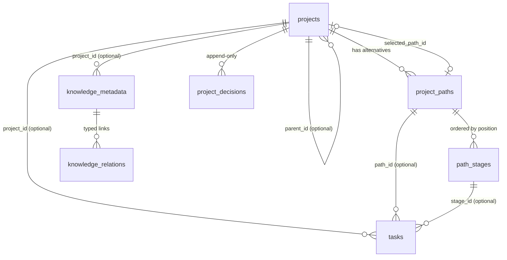

# Project Data Model (Milestone 1, schema version 1)

This describes the schema that **exists** on `feature/project-intelligence`. Source of truth:
[`app/migrations.py`](app/migrations.py). Business rules: [`app/services/projects.py`](app/services/projects.py),
[`app/services/tasks.py`](app/services/tasks.py), [`app/services/knowledge_meta.py`](app/services/knowledge_meta.py).

## Schema versioning

| Version | Meaning |
| :--- | :--- |
| 0 | Baseline: the tables that existed before this work, created by `create_baseline_schema()` (DDL unchanged). |
| 1 | Migration 1, "project intelligence foundation" (this document). |

* The version lives in `PRAGMA user_version`.
* `init_db()` runs on every start. It (1) creates the baseline tables if they're missing, (2) takes a `sqlite3.backup()` snapshot when an **existing** DB is behind, named `qwen_collective.pre-migration-v{cur}-to-v{target}-{UTC}.db` and stored next to the DB, then (3) applies pending migrations.
* Each migration runs in one `BEGIN IMMEDIATE … COMMIT` together with the version bump and a `PRAGMA foreign_key_check`. Any failure rolls the whole migration back.
* Existing tables only receive `ALTER TABLE … ADD COLUMN` with nullable columns. No table rebuilds.
* Verified on a **copy** of the production DB (from the 2026-10-14 01:09 backup): row counts preserved, user row and hash unchanged, `integrity_check = ok`, FK check clean, a pre-migration snapshot was written, and re-running did nothing.

## Entities

### `projects`
| Column | Notes |
| :--- | :--- |
| `id` | `prj-<uuid hex>` |
| `name` | 1–200 chars, unique (case-insensitive) |
| `description`, `objective`, `scope`, `constraints_text`, `success_criteria` | Free text, at most 20,000 chars (enforced in the service) |
| `priority` | `low · medium · high · critical` |
| `status` | `draft · planning · active · paused · completed · cancelled · archived` |
| `parent_id` | Optional FK → `projects`. Can't be self (CHECK). Cycles are rejected and depth is capped at 3 (service). |
| `owner` | Username of the creator |
| `selected_path_id` | Optional FK → `project_paths`. A trigger requires the Path to belong to the same project. |
| `knowledge_dir` | Vault folder `projects/<slug>-<last 8 of id>`, unique |
| `start_date`, `target_date`, `completed_date`, `review_date` | ISO dates. `start_date` is set the first time the project becomes active. `completed_date` is set on completion. |
| `created_at`, `updated_at`, `last_activity_at` | UTC ISO timestamps |

**Project status transitions** (service-enforced; every change is recorded as a decision):

| From | Allowed to |
| :--- | :--- |
| draft | planning, active, cancelled, archived |
| planning | draft, active, paused, cancelled |
| active | paused, completed, cancelled |
| paused | active, planning, cancelled |
| completed / cancelled | archived |
| archived | (none) |

### `project_paths`
Contains strategy fields: `rationale` (**required**), `description`, `assumptions`, `constraints_text`, `dependencies`, `resource_requirements`, `risks`, `estimated_cost` (≥ 0), `estimated_effort_hours` (≥ 0), `expected_outcome`, `expected_completion_date`, `forecast_confidence` (0–1). Path names are unique within a project.

| From | Allowed to |
| :--- | :--- |
| proposed | under_review, approved, rejected |
| under_review | proposed, approved, rejected |
| approved | rejected, superseded, **active (via Select only)** |
| active | paused, completed |
| paused | superseded, **active (via Select only)** |
| superseded / completed / rejected | (terminal) |

* **Only one active Path per project.** Enforced by the partial unique index `ux_one_active_path_per_project`, not just in code.
* `select_path()` is the only way a Path becomes `active`. It requires an approved or paused Path and a reason. It sets the previous active, approved, or paused selection to `superseded`, updates `selected_path_id`, and appends a `path_selection` decision recording from, to, reason, user, and time.
* Every other status change also requires a reason and is recorded as a `path_status_change` decision.
* **Estimates freeze once a Path leaves `proposed`/`under_review`.** Superseded Paths are never deleted, so historical estimates stay visible for comparison.

### `path_stages`
`position` is unique per Path. Other fields: `name`, `objective`, `description`, `prerequisites`, `expected_outputs`, `completion_criteria`, `estimated_effort_hours`, `actual_effort_hours`, `status`, and timestamps.

* M1 manages only the statuses **planned, active, and blocked**. The schema already allows `awaiting_review`, `completed`, and `skipped`, but the service refuses them until M2 completion gates exist.
* Reordering swaps a stage with its neighbour inside one transaction (using a temporary position of -1).
* Stages can't be added to or reordered on a terminal Path.

### `tasks` (existing table, extended)
New nullable columns: `project_id`, `path_id`, `stage_id`, `purpose`, `expected_output`, `completion_criteria`. Existing IDs (`task-xxxxxxxx`), statuses, and rows are unchanged. Global tasks keep these columns NULL and behave exactly as before.

**DB triggers** reject inconsistent traces on insert and update. A stage requires its own Path, and a Path requires its own project.

**Dispatch checks.** `validate_project_task_dispatch()` runs at creation, submission, and approval. It is deterministic and uses persisted facts only:
1. The project is `active`.
2. The project has a selected Path, and the task's Path *is* that Path and is `active`.
3. The task's stage belongs to that Path and is `planned` or `active`.
4. Purpose, expected output, and completion criteria are all non-empty.

Project tasks are **never created as `queued`**:
* A fully traceable task starts as `awaiting_approval`.
* Anything else starts as `draft`, and the UI lists the reasons.
* `approve_task()` runs the checks again and refuses if any fail.

> [!NOTE]
> Nothing in this codebase currently consumes `queued` tasks automatically. Any future executor must call `validate_project_task_dispatch()` again at dispatch time, because a Path or stage may change after approval.

### `knowledge_metadata`, `knowledge_relations`
See [KNOWLEDGE_INTEGRATION.md](KNOWLEDGE_INTEGRATION.md).

### `project_decisions` (append-only)
`decision_type ∈ {path_selection, path_status_change, project_status_change, project_parent_change}`. Each row also records `subject_id`, `from_value`, `to_value`, `rationale` (required), `decided_by`, `decided_at`, and an optional `evidence_knowledge_id`. The triggers `trg_decisions_no_update` and `trg_decisions_no_delete` abort any UPDATE or DELETE.

## Integrity guarantees and their limits

| Guarantee | Enforced by |
| :--- | :--- |
| Enum values, numeric ranges, non-empty names and rationales | CHECK constraints |
| Single active Path | Partial unique index |
| Selected Path belongs to the project | Trigger |
| Task trace consistency | Triggers (insert and update) |
| Knowledge enters only as captured or proposed; promotion needs a new recorded review | Triggers |
| Decisions immutable | Triggers |
| No parent cycles, max depth 3 | **Service only** (SQLite triggers can't use recursive CTEs) |
| Relation targets exist and belong to the scoped project | **Service only** (relations are polymorphic, so no FK is possible) |

> [!WARNING]
> Triggers and constraints protect against application bugs and naive writes. They are **not a security boundary** against anyone with write access to the SQLite file.
