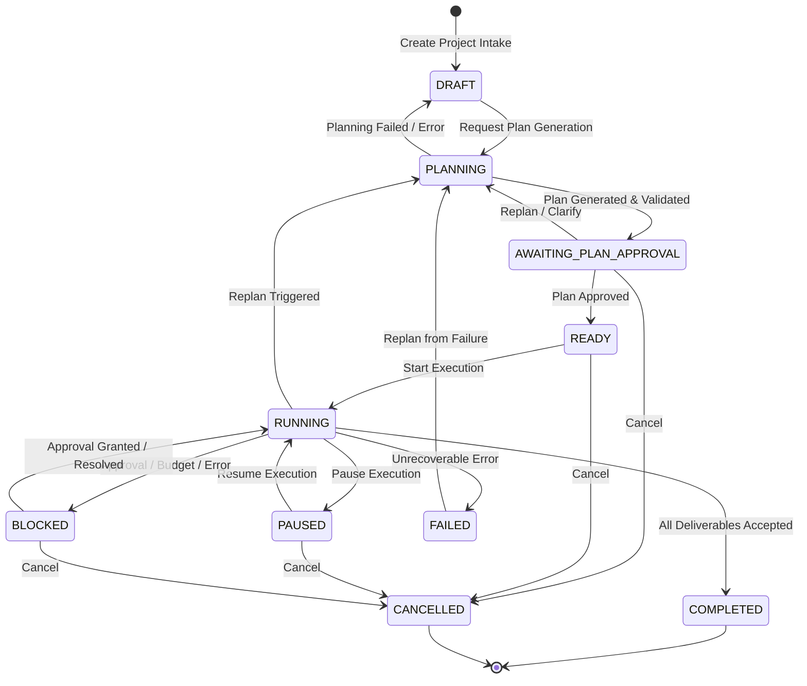

# Project Orchestrator Architecture

## 1. System Vision and Core Philosophy

The **Project Orchestrator** transforms Qwen Collective from a distributed task execution runner into an autonomous, goal-directed project coordination engine. Rather than requiring users to manually decompose high-level objectives into low-level tasks, configure worker assignments, and manually track artifacts, the Orchestrator provides an end-to-end autonomous lifecycle:

```
Goal Description (Natural Language)
               │
               ▼
   [Autonomous AI Planner] ──(Validation & Guardrails)──► [Plan Revisions]
               │
               ▼
    [Human Review Gate] ──(Approve / Edit / Clarify)
               │
               ▼
     [Execution Engine] ──(Capability Router)──► [Heterogeneous Worker Cluster]
               │                                      ├── VPS Worker (Linux/x86_64)
               ▼                                      ├── Laptop Worker (Inference/Ollama)
  [Deterministic Evaluator]                           └── Controller (Local Steps)
               │
               ▼
[Consolidated Deliverables] ──► [Final Project Completion]
```

### Architectural Principles

1. **Deterministic State Machine**: Every state transition is formal, validated, atomic, and recorded in an immutable audit ledger (`orchestration_events`). State cannot be skipped or desynchronized.
2. **Human-in-the-Loop by Default (Level 1 Autonomy)**: The system defaults to conservative human approval gates. Plans, tasks, budget increases, and final deliverables must be explicitly authorized unless higher autonomy is configured.
3. **Capability-Aware Scheduling**: Tasks are never statically bound to node names. The orchestrator inspects real-time runtime capabilities (Python versions, installed packages, Ollama models, available RAM, CPU load, and network health) before dispatching.
4. **Defense in Depth Against Prompt Injection**: Model outputs are strictly treated as untrusted data. Model generations can never synthesize arbitrary shell scripts or code execution payloads; all worker actions are constrained to an allowlisted script library or structured inference requests.
5. **Durable & Resilient to Restarts**: All orchestrator state resides in persistent SQLite tables. If the controller or workers reboot mid-project, leases expire cleanly, inflight tasks are reconciled, and execution resumes from the last durable checkpoint.
6. **Graceful Degradation & Autonomous Recovery**: Transient network errors, memory exhaustion, or model timeouts trigger exponential backoff, automated retry budgets, or structured replanning.

---

## 2. State Machine and Lifecycle

The orchestration lifecycle is governed by an audited state machine defined in `app/services/orchestration/states.py`.



### Complete Transition Matrix

| Current State | Allowed Next States | Trigger / Condition |
| :--- | :--- | :--- |
| `DRAFT` | `PLANNING`, `CANCELLED` | User or system triggers plan generation; or cancels project. |
| `PLANNING` | `AWAITING_PLAN_APPROVAL`, `DRAFT`, `FAILED` | Plan generated & validated; validation failure; or planner exception. |
| `AWAITING_PLAN_APPROVAL` | `READY`, `PLANNING`, `CANCELLED` | Human approves plan revision; human requests replan/clarification; or cancels. |
| `READY` | `RUNNING`, `CANCELLED` | Operator clicks "Start", or scheduler begins execution; or project cancelled. |
| `RUNNING` | `PAUSED`, `BLOCKED`, `COMPLETED`, `FAILED`, `CANCELLED`, `PLANNING` | Operator pauses; approval required or budget hit; all tasks complete & accepted; fatal error; cancelled; or replan triggered. |
| `PAUSED` | `RUNNING`, `CANCELLED` | Operator clicks "Resume"; or cancels. |
| `BLOCKED` | `RUNNING`, `FAILED`, `CANCELLED` | Approval granted or budget extended; operator rejection; or cancel. |
| `COMPLETED` | *(Terminal)* | Project deliverables generated, evaluated, and accepted. |
| `FAILED` | `PLANNING`, `CANCELLED` | Operator initiates recovery replan; or cancels. |
| `CANCELLED` | *(Terminal)* | Execution halted; remaining leases revoked. |

---

## 3. Subsystem Architecture

### 3.1 Planner and Task Graph

The Planner (`app/services/orchestration/planner.py`) produces structured plans matching the `task_graph` schema:

- **Plan Revisions**: Every plan iteration generates an immutable revision in `plan_revisions` with a sequential `revision_number`.
- **Topological Validation (Kahn's Algorithm)**: `task_graph.py` validates that task dependencies form a Directed Acyclic Graph (DAG) with no cycles, no dangling dependency references, and valid action types.
- **Action Allowlist**:
  - `library_script`: Pre-approved system diagnostic scripts (e.g. `sys_health_basic`). Code is maintained in the controller repository, never accepted from LLM prompts.
  - `inference`: Structured requests for local LLMs (specifying `model`, `prompt`, `min_ram_mb`, `temperature`).
  - `controller_step`: Local aggregation steps executed directly by the controller (e.g. `assemble_report`).
- **Prompt Injection Defense**: All natural-language objectives and inputs are scanned by regular-expression safety filters (`task_graph.py`) to block prompt injection phrases (e.g., `ignore previous instructions`, `system override`, `rm -rf`, curl pipes).
- **Automated JSON Repair**: When invoking small local models (e.g. Qwen 1.5B or Llama 1B), malformed JSON responses undergo up to 2 repair iterations using targeted error prompts before returning to DRAFT.

### 3.2 Capability-Aware Model and Worker Router

The router (`app/services/orchestration/model_router.py`) maps abstract plan requirements to concrete physical nodes:

- **Dynamic Inventory**: Scans `infrastructure_nodes` and `worker_auth_tokens`.
- **Capability Inference**:
  - Script tasks require `python-3.*` in `installed_runtimes_json`.
  - Inference tasks require `ollama` in runtimes, target model in `available_models_json`, and sufficient free RAM.
- **Node Health & Freshness**: Nodes with `health_status != 'online'` or whose `last_contact_at` heartbeat is older than 60 seconds are excluded from candidate pools.
- **Scoring & Placement**: Nodes are ranked by free memory, role specificity (`vps_worker` for external scripts, `inference_node` for LLM tasks), and latency.

### 3.3 Execution Engine and Scheduler

The execution loop (`app/services/orchestration/engine.py`) operates concurrently via the FastAPI lifespan:

- **Scheduler Lock**: Implements a distributed lock in SQLite (`orchestration_scheduler_lock`) with a 15-second TTL to guarantee single-leader execution across processes.
- **Tick Cycle**:
  1. `_collect_results`: Sweeps completed worker tasks, updates attempt status, parses stdout/artifacts, logs completion events.
  2. `_check_inflight`: Detects expired leases, worker disconnections, and timeouts; triggers recovery policies.
  3. `_dispatch_ready_tasks`: Identifies tasks whose dependencies are satisfied; verifies capability match; checks approval status; creates worker tasks with deterministic idempotency keys (`orch:{task_id}:{attempt}`).
  4. `_evaluate_deliverables`: When all tasks conclude, triggers deliverable assembly and evaluation.

### 3.4 Recovery, Leases, and Health Management

- **Lease Reconciliation**: Standard worker leases have a 10-minute timeout. If a worker goes silent, the engine classifies the failure, updates `orchestration_task_attempts`, and triggers backoff.
- **Failure Classification**: Distinguishes between `timeout`, `out_of_memory`, `connection_lost`, `script_error`, and `model_error`.
- **Retry Budgets**: Configured per task (default 2 retries). If retries are exhausted, the engine pauses into `BLOCKED` or triggers replanning.

### 3.5 Deterministic Evaluator and Reporting

- **Verification Pipeline** (`evaluator.py`): Performs deterministic schema checks on task outputs (e.g. validating `qc.health.v1` schema for health telemetry).
- **Evidence-Based Deliverables** (`reporting.py`): Assembles reports containing node summaries, telemetry comparisons, and LLM narrative analyses.
- **Integrity**: Clear visual and metadata separation between verified machine telemetry and AI-generated narrative summaries.

### 3.6 Artifact and Evidence Pipeline

- **Registration** (`artifact_manager.py`): Every artifact generated by workers or the controller is registered in `orchestration_artifact_metadata` with its SHA-256 digest, byte size, creation timestamp, and producing task ID.
- **Safe Traversal & Download**: All artifact download requests verify that the resolved path resides strictly within the configured `evidence_dir` or `data_dir/orchestrator_artifacts`. Path traversal (`..`, symlinks, absolute paths) is strictly rejected. Downloads include `X-Content-Type-Options: nosniff` and integrity headers.

---

## 4. Autonomy Levels and Human Gatekeeping

The Orchestrator implements four distinct autonomy tiers (0 through 3), defaulting to Level 1:

| Level | Name | Task Dispatch Policy | Deliverable Acceptance | Failure Recovery |
| :---: | :--- | :--- | :--- | :--- |
| **0** | **Manual Step** | Requires explicit operator step trigger (`POST /step`) for every task. | Human review required. | Operator manual retry only. |
| **1** | **Assisted (Default)** | Tasks require explicit operator approval (`POST /approvals/{id}`). | Human review required. | Operator decides retry or replan. |
| **2** | **Supervised Auto** | Allowlisted low-risk tasks dispatch automatically. High-risk tasks pause for approval. | Deliverables auto-accepted if deterministic checks pass (audited as "orchestrator (auto)"). | Automatic task retry up to budget. |
| **3** | **Fully Autonomous** | All valid tasks dispatch automatically. | Auto-accepted on schema validation pass. | Autonomous single-pass replan on task failure; new plan requires approval. |

---

## 5. Known Gaps and Design Boundaries

1. **Worker Capabilities Persistence**: Runtimes and models are derived dynamically from node heartbeats and installed runtime JSON fields. Explicit capability tagging in the database is not yet persisted.
2. **AI-as-Judge Critic Pass**: Planning verification relies on deterministic structural and schema validation; an LLM critic evaluation pass is not yet implemented.
3. **No External Web Tools**: The system does not currently possess web crawling or internet research tools; tasks are strictly confined to internal diagnostics, cluster scripts, and local Ollama inference.
4. **Plan Editor**: In the current web UI, plan editing is performed via a JSON editor rather than a drag-and-drop visual node graph.
5. **Client Polling**: The frontend uses 2.5-second polling rather than Server-Sent Events (SSE) or WebSockets.
