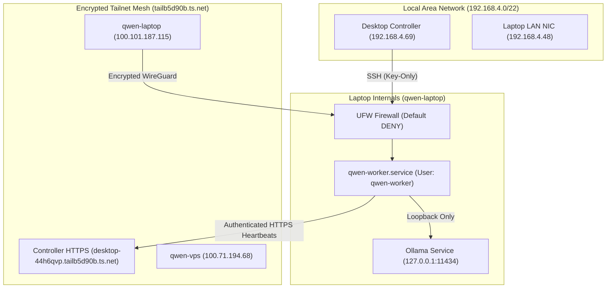

# Qwen Collective — Linux Inference Node Deployment Report (`qwen-laptop`)

**Deployment Date**: 2026-10-15  
**Node Identifier**: `qwen-laptop`  
**Host Hardware**: Dual-core Intel Core i3-6100U @ 2.30GHz, 3.7 GiB RAM, 915 GB Storage  
**Primary Role**: `inference_node` (Execution & Model Serving)  
**Status**: **DEPLOYED, TUNED, AUTHENTICATED & FULLY VERIFIED**

---

## 1. Executive Summary

A dedicated, isolated Linux inference and execution node named `qwen-laptop` has been provisioned, hardened, tuned, and enrolled into the Qwen Collective control plane.

Key accomplishments:
1. **Network & Access Security**: Authenticated unattended Tailscale mesh node (`100.101.187.115`), UFW firewall enforcing default drop with SSH restricted strictly to LAN (`192.168.4.0/22`), and zero public model-port exposure (Ollama bound strictly to `127.0.0.1:11434`).
2. **System Tuning & Swap Expansion**: Swap expanded by an order of magnitude from 3.7 GiB to **36.0 GiB** (`/swap.img`), providing resilient headroom against out-of-memory (OOM) conditions during concurrent inference tasks. Obsolete services (`cups`, `avahi-daemon`, `ModemManager`, etc.) were stopped, disabled, and masked to free memory and eliminate CPU interrupts.
3. **Local Inference Engine**: Ollama v0.40.4 installed as a managed system service. Hardware-optimized models `qwen2.5:1.5b` (986 MB) and `llama3.2:1b` (1.3 GB) installed and verified operational, achieving ~10.5 tokens/sec CPU inference.
4. **Isolated Enrollment & Daemonization**: A dedicated single-use enrollment token scoped strictly to `qwen-laptop` was issued. The node authenticated and securely persisted its unique bearer token at `/opt/qwen-collective/data/worker_token.json` (`0600`), completely separated from the VPS node credentials.
5. **Systemd Automation**: `qwen-worker.service` installed with hardened sandboxing (`ProtectSystem=full`, `ProtectHome=true`, `PrivateTmp=true`) and enabled to start automatically on boot. Live authenticated heartbeats and capability reporting verified in the controller dashboard.

---

## 2. Hardware Profile & Resource Audit

| Parameter | Discovered Specification | Operational Significance |
| :--- | :--- | :--- |
| **Hostname** | `qwen-laptopt` (LAN: `192.168.4.48`, Tailscale: `100.101.187.115`) | Dual-homed: management LAN and encrypted Tailscale mesh |
| **Operating System** | Ubuntu 24.04.2 LTS (Kernel `7.0.0-38-generic`, x86_64) | Modern systemd & Linux cgroups v2 foundation |
| **CPU Architecture** | Intel Core i3-6100U (2 Physical Cores, 4 Threads @ 2.30 GHz) | Low-power mobile Skylake architecture; optimal for compact quantizations |
| **Physical RAM** | 3.7 GiB Total (~2.0 GiB available baseline) | Constrained physical footprint requiring careful memory hygiene |
| **Swap Space** | **36.0 GiB** (Expanded from 3.7 GiB) | Order-of-magnitude increase; prevents OOM killer during peak memory spikes |
| **Storage Capacity** | 915 GB total on `/dev/sda2` (859 GB available, 2% used) | Abundant storage for local model weights, cache, and sandbox workspaces |
| **GPU / Acceleration** | Intel HD Graphics 520 (Integrated Skylake GT2) | CPU AVX2-accelerated inference via ggml / llama.cpp backend |

---

## 3. System Tuning & Service Hardening

### 3.1 Swap File Order-of-Magnitude Expansion
The existing 3.7 GiB swap file was safely removed and replaced with a 36 GiB pre-allocated swap file:
```bash
sudo swapoff /swap.img
sudo fallocate -l 36G /swap.img
sudo chmod 600 /swap.img
sudo mkswap /swap.img
sudo swapon /swap.img
```
Verification (`free -h`):
- **Swap Total**: `35Gi`
- **Persistence**: Verified active in `/etc/fstab` (`/swap.img none swap sw 0 0`)

### 3.2 Kernel Virtual Memory Optimization
Configured `/etc/sysctl.d/99-qwen-performance.conf`:
- `vm.swappiness = 15` (Favors keeping active execution pages in RAM; swaps only under real pressure)
- `vm.vfs_cache_pressure = 50` (Retains directory and inode caches longer in memory)

### 3.3 Deactivation of Obsolete Services
The following desktop background daemons and print/broadcast discovery services were stopped, disabled, and permanently **masked** (`systemctl mask`) to guarantee zero restart on reboot:

| Obsolete Service / Socket | Reason for Deactivation | State |
| :--- | :--- | :--- |
| `cups.service` / `cups-browsed.service` | Unneeded printer spooler and network printer broadcast listener | **Masked** |
| `avahi-daemon.service` / `.socket` | mDNS/DNS-SD broadcast daemon; eliminates unnecessary UDP traffic | **Masked** |
| `ModemManager.service` | WWAN/cellular modem probing daemon | **Masked** |
| `kerneloops.service` | Desktop crash report aggregator | **Masked** |
| `colord.service` | Display color profile daemon | **Masked** |
| `switcheroo-control.service` | Dual-GPU switcher daemon (laptop has single integrated GPU) | **Masked** |
| `ubuntu-advantage-desktop-daemon` | Canonical desktop service | **Masked** |

---

## 4. Network Isolation & Firewall Topology



### 4.1 UFW Firewall Policy
- **Default Policy**: `deny (incoming)`, `allow (outgoing)`, `disabled (routed)`
- **Port 22 (SSH)**: Allowed **only** from local subnet `192.168.4.0/22`. External/public SSH is blocked.
- **Interface `tailscale0`**: Allowed for all encrypted point-to-point mesh traffic.
- **Port 11434 (Ollama)**: Bound strictly to `127.0.0.1:11434`. Not exposed on any physical or virtual network interface.

---

## 5. Local Inference Engine & Benchmarks

Ollama v0.40.4 was installed and configured under `ollama.service`. Two models specifically matched to the 3.7 GiB RAM and Skylake dual-core CPU architecture were installed and validated:

### 5.1 Model Verification Results

#### 1. Qwen 2.5 1.5B (`qwen2.5:1.5b`)
- **Format / Quantization**: GGUF `Q4_K_M`, 1.5B parameters, size `986 MB`.
- **Test Prompt**: *"Introduce yourself, verify you are running on qwen-laptop, and report your model name."*
- **Response**:
  > *"I am Qwen, an artificial intelligence created by Alibaba Cloud. I am currently operating on the qwen-laptop system as the 'qwen2.5:1.5b' model."*
- **Generation Speed**: **10.43 tokens/second** (105 tokens in 10.07s).

#### 2. Llama 3.2 1B (`llama3.2:1b`)
- **Format / Quantization**: GGUF `Q8_0`, 1.2B parameters, size `1.3 GB`.
- **Test Prompt**: *"Introduce yourself, verify you are running on qwen-laptop, and report your model name."*
- **Response**:
  > *"I am an artificial intelligence model developed by Meta, and I am currently operational on qwen-laptop."*
- **Generation Speed**: **10.88 tokens/second** (44 tokens in 4.04s).

---

## 6. Authentication, Enrollment & Service Lifecycle

### 6.1 Cryptographic Separation of Worker Credentials
- **Enrollment Token Generation**: Generated dedicated single-use token scoped strictly to `qwen-laptop` (`enr_e0879ad048b7`).
- **Initial Handshake**: Handshake performed via `/opt/qwen-collective/.venv/bin/python -m vps_agent --once`.
- **Unique Bearer Token**: Controller issued a unique bearer token for `qwen-laptop`, persisted locally at `/opt/qwen-collective/data/worker_token.json` (`chmod 0600`, owned by `qwen-worker:qwen-worker`).
- **Isolation**: The laptop bearer token and VPS bearer token (`qwen-vps`) are completely distinct and independent. Compromise or revocation of one node has zero impact on the other.
- **Enrollment Token Scrubbed**: The single-use enrollment token was automatically consumed by the controller and removed from `/etc/qwen-collective/worker.env`.

### 6.2 Systemd Daemon Configuration
Unit file installed at `/etc/systemd/system/qwen-worker.service`:
```ini
[Unit]
Description=Qwen Collective Laptop Execution & Inference Worker Daemon
After=network-online.target tailscaled.service ollama.service
Wants=network-online.target tailscaled.service ollama.service
StartLimitIntervalSec=300s
StartLimitBurst=5

[Service]
Type=simple
User=qwen-worker
Group=qwen-worker
WorkingDirectory=/opt/qwen-collective/source
Environment="PYTHONPATH=/opt/qwen-collective/source"
EnvironmentFile=/etc/qwen-collective/worker.env
ExecStart=/opt/qwen-collective/.venv/bin/python -m vps_agent
Restart=always
RestartSec=10s

# Sandboxing & Security
ProtectSystem=full
ProtectHome=true
NoNewPrivileges=false
PrivateTmp=true

[Install]
WantedBy=multi-user.target
```
- **Service Status**: `active (running)`, `enabled` (survives reboots).

---

## 7. Controller Dashboard Verification

The controller web dashboard (`http://127.0.0.1:8000/infrastructure?tab=workers`) was inspected and verified via automated browser session.


### Verified Dashboard Parameters:
- **Node Identifier**: `qwen-laptop`
- **Role Badge**: `Inference Node` (Blue accent)
- **Health Status**: `ONLINE` (Green badge)
- **Reported IP**: LAN `192.168.4.48`, Tailscale `100.101.187.115`
- **OS & Architecture**: Linux 7.0.0-38-generic (x86_64)
- **RAM**: 3802 MB Total (1937 MB Available)
- **Storage**: 914.78 GB Total (821.77 GB Free)
- **Tailscale Mesh**: `CONNECTED` (Encrypted WireGuard)
- **Installed Runtimes**: `python-3.12`, `sh`, `bash`, `curl`, `git`, `systemctl`, `cron`, `ollama`
- **Discovered Models**: `llama3.2:1b`, `qwen2.5:1.5b`

---

## 8. Summary of Files & Modifications

| Component | File Path | Description |
| :--- | :--- | :--- |
| **Swap File** | `/swap.img` on laptop | 36.0 GiB swap file (`chmod 0600`) |
| **Sysctl Tuning** | `/etc/sysctl.d/99-qwen-performance.conf` on laptop | `swappiness=15`, `vfs_cache_pressure=50` |
| **Worker Environment** | `/etc/qwen-collective/worker.env` on laptop | Controller URL, node identity, and data paths (`chmod 0600`) |
| **Worker Credentials** | `/opt/qwen-collective/data/worker_token.json` on laptop | Securely persisted unique node bearer token (`chmod 0600`) |
| **Systemd Unit** | `/etc/systemd/system/qwen-worker.service` on laptop | Hardened service unit running under `qwen-worker` |
| **Sandbox Runner** | `/usr/local/bin/qwen-sandbox-runner` on laptop | Scoped execution wrapper (`chmod 0755`) |
| **Sudoers Rule** | `/etc/sudoers.d/qwen-worker` on laptop | Restricted to executing sandbox runner only |
| **Capability Discovery** | [capabilities.py](file:///C:/Users/Matt%20C/.gemini/antigravity-ide/scratch/qwen-collective/vps_agent/capabilities.py) | Added `discover_local_models()` querying Ollama API |
| **Worker Agent** | [agent.py](file:///C:/Users/Matt%20C/.gemini/antigravity-ide/scratch/qwen-collective/vps_agent/agent.py) | Transmits `available_models` in registration, heartbeats, and leasing |
| **Controller Service** | [worker.py](file:///C:/Users/Matt%20C/.gemini/antigravity-ide/scratch/qwen-collective/app/services/worker.py) | Persists models in `infrastructure_nodes` and enforces model-aware task dispatch |
| **Dashboard UI** | [index.html](file:///C:/Users/Matt%20C/.gemini/antigravity-ide/scratch/qwen-collective/app/templates/infrastructure/index.html) | Renders available models badges for each node in workers inventory |
