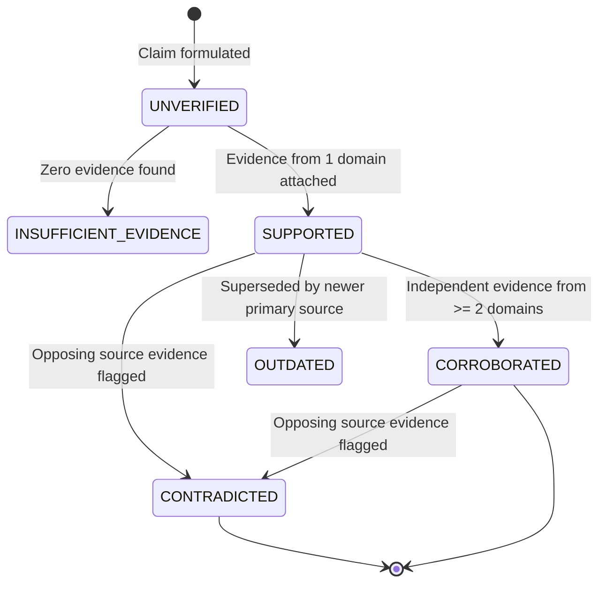

# Qwen Collective — Source Verification & Citation Engine Specification

## 1. Overview & Research Methodology

The Qwen Collective Research Engine treats all retrieved web content as untrusted observational evidence rather than authoritative truth. To prevent AI hallucination, citation forgery, or unwarranted elevation of opinion into fact, the subsystem employs:
1. **Deterministic Citation Auditing**: No citation is accepted unless it maps to an actual retrieved source in `research_sources`.
2. **Structured Evidence Ledger**: Material claims are tracked at the assertion level with supporting excerpts, confidence scores, and conflict flags.
3. **Multi-Domain Corroboration**: Claims are elevated to `CORROBORATED` only when substantiated by independent sources from distinct second-level domains.
4. **Epistemic Classification**: Factual statements, inferences, estimates, and opinions are explicitly categorized.

---

## 2. Epistemic Classification of Claims

When claims are extracted or evaluated by the Orchestrator, each claim is classified into one of five categories:
- **`fact`**: Empirical observation or verified historical datum directly attested by reputable primary or secondary sources.
- **`inference`**: Reasoned deduction derived from verified facts; assumptions and logic must be explicitly stated.
- **`estimate`**: Numerical approximation or projection; underlying methodology and error margins must be documented.
- **`opinion`**: Perspective, commentary, or normative position attributed to a specific entity or author.
- **`unknown`**: An open research question or hypothesis where sufficient evidence is unavailable.

---

## 3. Evidence Ledger Lifecycle & States

Every tracked claim progresses through an auditable state machine:



### Verification States Defined
- **`UNVERIFIED`**: Claim identified in research plan but not yet matched with retrieved source text.
- **`SUPPORTED`**: Supported by an exact quote or passage from a retrieved document in the project's source library.
- **`CORROBORATED`**: Supported by two or more independent sources hosted on distinct registered second-level domains (e.g., `python.org` and `wikipedia.org`). Synergistic copies from news syndicates do not count as independent corroboration.
- **`CONTRADICTED`**: Another retrieved source asserts contradictory data or facts. Contradiction details and conflicting passages are preserved in the ledger.
- **`INSUFFICIENT_EVIDENCE`**: Available documents do not provide clear evidentiary support.
- **`OUTDATED`**: A source that was previously factual has been superseded by a more recent release or specification.

---

## 4. Citation Resolution & Deterministic Auditing

### 4.1. Inline Citations
All research deliverables generated by the Orchestrator must employ numerical bracketed citations (e.g., `[1]`, `[2]`, `[1, 3]`).

### 4.2. Validation Rules (`validate_report_citations`)
Before any research deliverable or synthesis artifact is accepted:
1. **Index Existence**: Every numerical marker `[N]` in the report markdown must map to index `N` in the attached project sources list.
2. **Source Ingestion Check**: Source `N` must have a valid record in SQLite table `research_sources` for the current project.
3. **Retrieval Verification**: The source must have non-empty extracted text and status `'fetched'` or `'extracted'`. Unretrieved URLs (e.g. HTTP 404, 403, or blocked destinations) cannot be cited.
4. **Unsupported Claim Detection**: Material claims lacking attached supporting evidence are flagged in the audit report.

If any citation is unresolved or invalid, the deliverable is rejected and returned to the Orchestrator for plan repair or regeneration.

---

## 5. Formal Bibliography Formatting

The Citation Engine automatically compiles an auditable bibliography appended to every generated report:

```markdown
## References

[1] **Download Python | Python.org** — *Python Software Foundation*
    - URL: https://www.python.org/downloads/
    - Published: 2026-10-15 | Retrieved: 2026-10-18
    - Reliability Score: 0.95

[2] **Python Release Python 3.15.0 | Python.org** — *Python Software Foundation*
    - URL: https://www.python.org/downloads/latest/
    - Published: 2026-10-12 | Retrieved: 2026-10-18
    - Reliability Score: 0.95
```
