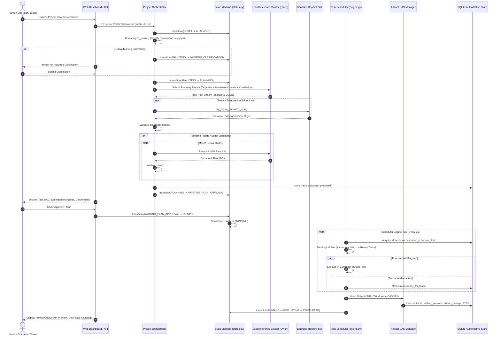
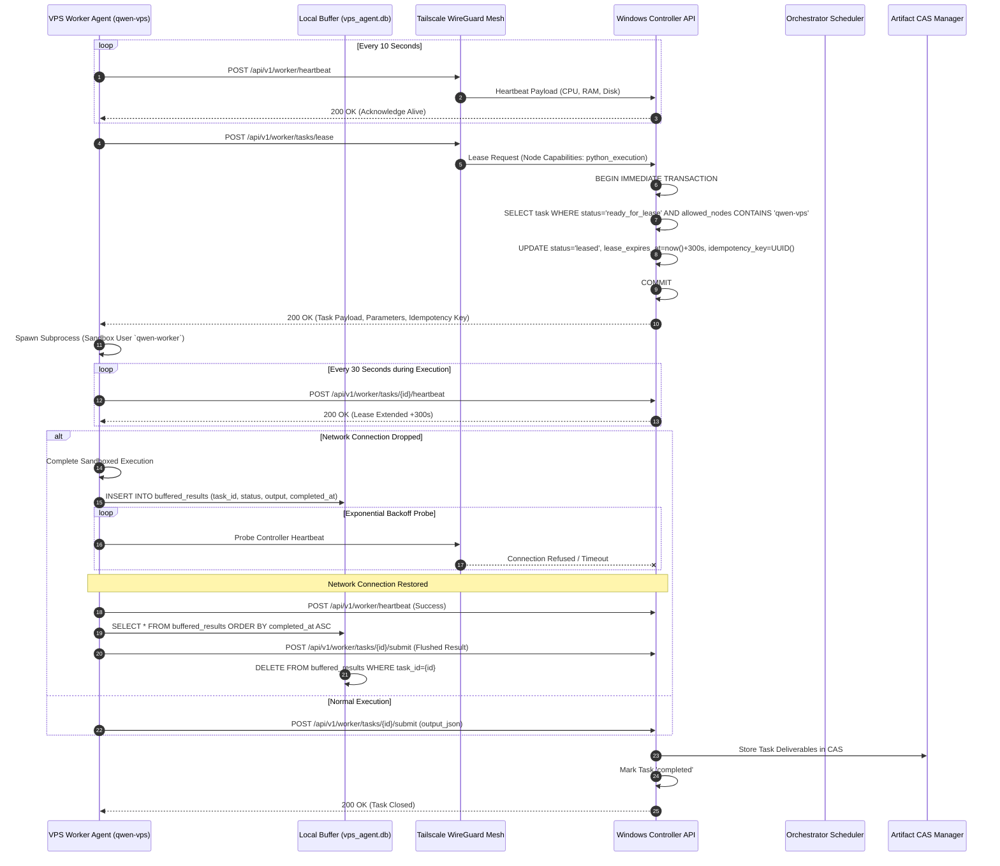
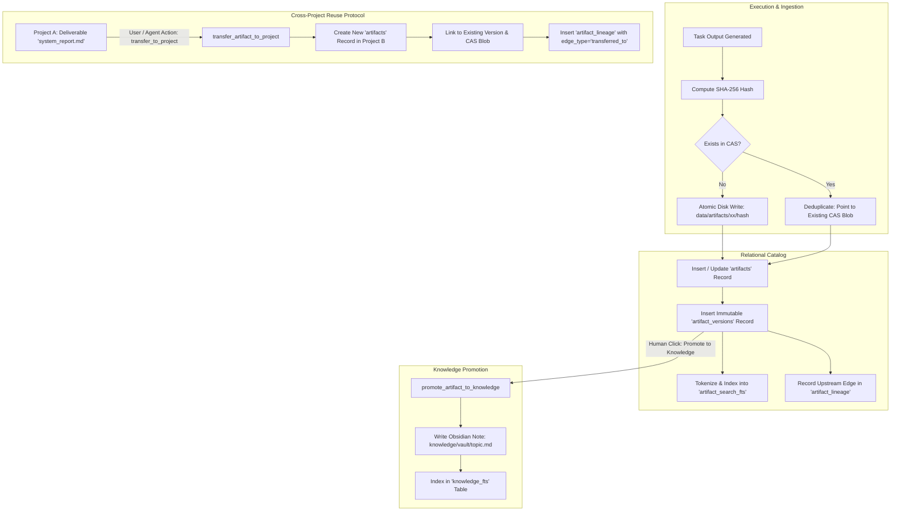
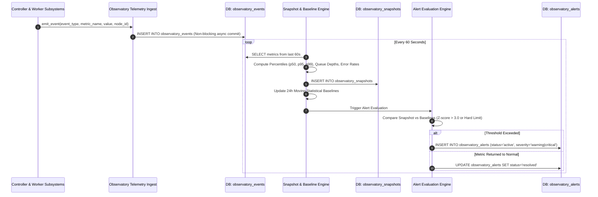

# Qwen Collective: System Interaction Patterns & Visual Execution Flows

> **Target Audience**: Systems architects, distributed systems engineers, and reasoning LLMs that trace multi-agent execution flows.  
> **Purpose**: This document provides end-to-end visual sequence diagrams and architectural flowcharts using Mermaid syntax. It maps out the exact message passing, database state mutations, and error recovery sequences across the heterogeneous cluster.

---

## 1. End-to-End Autonomous Project Lifecycle

The following sequence illustrates the entire journey of a project—from raw user prompt to verified deliverables stored in Content-Addressable Storage (CAS).



---

## 2. Distributed Worker Task Leasing & Disconnect Resiliency

The cloud VPS companion worker operates strictly in an outbound pull model with local buffering to survive network partitions over Tailscale.



---

## 3. Continuous Web Research, Evidence Extraction & Citation Pipeline

The continuous research engine executes on the controller to discover, verify, and cite real-world evidence without external hallucination.

```mermaid
flowchart TD
    A[Orchestrator Dispatches 'research_search'] --> B[Search Manager]
    B --> C{Select Provider}
    C -->|Priority 1| D[DuckDuckGo HTML Engine]
    C -->|Priority 2| E[SearXNG Meta-Search API]
    C -->|Priority 3| F[Custom Search REST API]
    
    D & E & F --> G[Rank & Filter Top 10 URLs]
    G --> H[Record in research_queries & research_search_results]
    
    H --> I[Orchestrator Dispatches 'research_fetch']
    I --> J[SSRF-Hardened HTTP Fetcher]
    
    J --> K{Evaluate Response}
    K -->|200 OK with Clean HTML| L[Trafilatura / BeautifulSoup4 Text Extraction]
    K -->|403 Barrier / SPA Detected| M[Headless Chromium Sandbox Fallback]
    
    M -->|Render DOM & Execute JS| L
    L --> N[Persist Source into research_sources Table]
    
    N --> O[Orchestrator Dispatches 'research_verify']
    O --> P[Claim Extraction: Split into Atomic Assertions]
    P --> Q[Passage Semantic Matching & TF-IDF Scoring]
    Q --> R[Populate research_claims & research_evidence Ledgers]
    
    R --> S[Orchestrator Dispatches 'research_synthesize']
    S --> T[Generate Markdown Report with Deterministic Citations]
    T --> U[Citation Audit Engine: Verify Every Bracketed Claim [n]]
    U --> V[Emit CAS Artifacts: research_report.md & citation_audit.json]
```

---

## 4. Content-Addressable Storage (CAS) & Cross-Project Artifact Lineage

Every asset output is stored deterministically by its cryptographic hash and can be transferred between projects with full lineage tracking.



---

## 5. System Observatory Telemetry & Anomaly Detection Flow

Telemetry events are ingested asynchronously, aggregated into rolling snapshots, and evaluated against statistical baselines.


