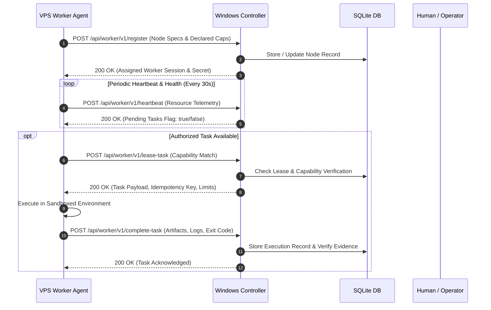

# Qwen Collective — VPS Agent Protocol Specification

## 1. Overview & Communication Philosophy

The VPS agent protocol provides a resilient, secure, pull-based communication channel between remote execution workers (such as the VPS) and the central Windows Controller.

---

## 2. Security Invariants

1. **Outbound Pull Architecture:**
   * Workers initiate all connections outbound over Tailscale WireGuard mesh networking.
   * No listening ports need to be exposed on the public internet.
2. **Mutual Identity Authentication:**
   * Workers authenticate with a dedicated, high-entropy token (`QC_AUTH_TOKEN`, >= 32 characters).
   * Constant-time comparison prevents timing analysis attacks.
3. **Leasing & Expiration Guards:**
   * Work is leased with a finite lease duration (e.g. 5 minutes).
   * If a worker crashes or drops connection, the controller lease expires and the task is safely recovered without duplicate execution.
4. **Idempotency Keys:**
   * Every job dispatch contains an idempotency key. Duplicate submissions or reconnections will not re-execute side effects.

---

## 3. Protocol Message Endpoints (Planned for Milestone 2)

* `POST /api/worker/v1/register`: Advertises hardware specs, OS version, runtimes, and declared capabilities.
* `POST /api/worker/v1/heartbeat`: Reports CPU, RAM, disk, active jobs, and connection state.
* `POST /api/worker/v1/lease-task`: Atomically claims an eligible task matching verified capabilities.
* `POST /api/worker/v1/heartbeat-task`: Renews task lease during long-running operations.
* `POST /api/worker/v1/complete-task`: Submits stdout/stderr references, deliverables, measurements, and exit codes.

---

## 4. Status

* **Status:** Architectural specification complete. Milestone 1 establishes the controller registry; Milestone 2 implements the protocol agent.
