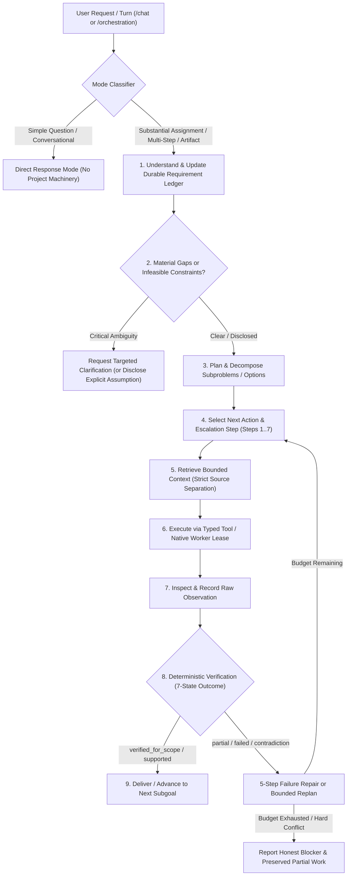

# Increment 18: Deliberate General-Purpose Assistant & Persisted Task-Solving Architecture

**Branch**: `feature/increment18-deliberate-task-solving-loop`  
**Status**: Implemented (Reversible Development / Review Branch)  
**Target Hardware Profile**: Constrained Local / Distributed Edge Hosts (~3.7 GiB to 4 GiB RAM per node, `qwen2.5:1.5b` and `qwen2.5:3b` via loopback Ollama)

---

## 1. Executive Summary & Capability Goal

Increment 18 transforms Qwen Collective from a set of specialized orchestration, research, and artifact subsystems into a coherent, deliberate, general-purpose assistant capable of:
1. **Understanding requests & preserving user intent** across multi-turn conversations, mid-flight requirement updates, ambiguity resolution, and scope changes.
2. **Researching unfamiliar subjects** using source-separated retrieval, claim-level verification, contradiction detection, and freshness/scope checks.
3. **Reasoning through complex problems** via explicit subproblem decomposition, exact `Decimal` calculation, alternative comparison against hard/soft constraints, and bounded adaptive escalation.
4. **Writing and testing software** against pinned, independent acceptance tests in isolated runners without exposing hidden test oracles to model prompts.
5. **Creating useful, provenance-bound artifacts** and **managing substantial projects over time** across interruptions, restarts, and requirement revisions.

Rather than assuming that small local models (`qwen2.5:1.5b`, `qwen2.5:3b`) behave like frontier models when given longer prompts or more agents, this architecture uses **persisted state**, **deterministic tools**, **strict source/instruction separation**, **bounded context assembly**, **independent verification**, and **measured role routing** to achieve dependable task completion with honest limits.

---

## 2. Current-State vs. Target-State Mapping

### 2.1 Current Request → Planning → Execution → Verification → Delivery Path (Before Increment 18)

| Path Stage | Implemented Module(s) | Connected to UI / API? | Test / Script Only? | Identified Gaps Addressed in Increment 18 |
| :--- | :--- | :--- | :--- | :--- |
| **Conversational Entry (`/chat`)** | `app/routes/chat.py`, `app/services/chat_context.py` | Yes (`/chat`, `/chat/send`) | No | Previously injected passive project markdown into a single chat completion (`max_tokens=2048`). Did not distinguish simple direct questions from durable project assignments, nor expose structured project progress, active step, blockers, or steering controls. |
| **Intake & Requirement Parsing** | `app/services/orchestration/intake.py`, `planner.py:analyze_intake` | Yes (via `/projects/{id}/orchestration/intake`) | No | `RequirementLedger` existed in memory during plan generation/evaluation (`RequirementKind`, `RequirementHardness`), but lacked a durable versioned table tracking user decisions/corrections, explicit assumptions, material missing information, requirement dependencies, verification methods/statuses, and selective artifact invalidation upon mid-flight steering. |
| **Planning & Task Graph** | `app/services/orchestration/planner.py`, `task_graph.py`, `contract.py` | Yes (`/orchestration/plan`) | No | Supported template & AI plans (`PLANNER_MAX_TOKENS=2048`), but lacked adaptive effort escalation, subproblem option matrices, and selective re-planning that preserves unaffected accepted work when constraints change mid-run. |
| **Context Assembly & Project Memory** | `app/services/orchestration/context_manager.py`, `knowledge_store.py` | Yes (used by `engine.py`) | No | **Defect fixed in Increment 18**: `_format_input_for_inference` and `build_inference_prompt` previously defaulted missing `verification_status` to `"supported"` (`c.get("verification_status") or "supported"`). Also lacked persistent structured project memory (`project_memory_state`) for candidate approaches, failed approaches, unresolved contradictions, and downstream invalidation. |
| **Execution & Native Task Leasing** | `app/services/orchestration/engine.py`, `model_router.py`, `vps_agent/executor.py` | Yes (`/api/worker/*`, `/orchestration/*`) | No | Prompt/token caps were uncoordinated across `planner.py` (2,048 tokens), `model_router.py` (8,000 chars), `context_manager.py` (5,200 chars), and `vps_agent/executor.py` (1,024 tokens / 10,000 chars). Role routing defaulted to `1.5b` even when `3b` was required for multi-constraint reasoning or structured JSON/code bundles. |
| **Financial & Claim Verification** | `app/services/orchestration/financial_ledger.py`, `app/services/research/financial_reasoning.py`, `claim_contracts.py` | Partial (used by research ledger) | Mostly exercised in targeted tests | Exact `Decimal` cent-level reconciliation and source-scope claim contracts existed, but were not wired into a general-purpose deliberate reasoning & option-comparison tool catalogue accessible to project runs. |
| **Software Proposal & Protected Verification** | `app/services/orchestration/code_proposals.py`, `protected_verification.py`, `code_sandbox.py` | Held behind explicit dev injection | Exercised in isolated tests | Provided append-only `software_review_items` and isolated test verification, but lacked a general-purpose iterative failure-repair cycle (`proposed -> observed -> verified_for_scope / failed`) with hidden oracle isolation. |

---

## 3. Unified Persisted Task-Solving Cycle

Increment 18 unifies conversational interaction and project orchestration around **one persisted task-solving cycle** without creating a competing agent loop or duplicate database:

### 3.1 Two Execution Modes
1. **Direct-Response Mode (`mode = "direct_response"`)**:
   - Triggered for self-contained questions, explanations, or lightweight calculations that require no durable deliverables, multi-stage research, or code/test execution.
   - Returns an immediate response without creating unnecessary projects, task graphs, or artifacts.
2. **Durable-Project Mode (`mode = "durable_project"`)**:
   - Triggered for substantial assignments involving multiple deliverables, external/document research, multi-constraint option comparisons, financial/data reconciliation, code generation with tests, or multi-turn project management.
   - Persists state across `orchestration_runs`, `project_requirement_items`, `project_requirement_revisions`, `project_memory_state`, `orchestration_tasks`, and `artifacts`.

---

## 4. Prompt, Context, and Output Budget Alignment

To prevent silent prompt clipping or truncated structured outputs across small local models (`4096`-token context window on 3.7–4.0 GiB RAM hosts), Increment 18 coordinates budgets across all layers:

| Component | Parameter | Previous Value | Coordinated Increment 18 Policy |
| :--- | :--- | :--- | :--- |
| `context_manager.py` | `DEFAULT_CONTEXT_CHARS` / `PER_INPUT_CHARS` | `5200` / `2400` | `5200` chars default (`2400` per input), expandable up to `6800` chars for multi-source synthesis while staying strictly below the `8000`-char router/worker ceiling. |
| `model_router.py` | `MAX_PROMPT_CHARS` | `8000` | `8000` chars hard cap; logs explicit `prompt_truncated` warning if caller exceeds budget instead of silently clipping critical instructions. |
| `planner.py` | `PLANNER_MAX_TOKENS` | `2048` | Coordinated with worker `MAX_NUM_PREDICT` (`2048` tokens max for structured plans/code bundles; `calculate_planner_token_budget` ensures prompt + generation fits within `4096` context window). |
| `vps_agent/executor.py` | `MAX_NUM_PREDICT` / `MAX_OUTPUT_CHARS` | `1024` / `10000` | `MAX_NUM_PREDICT` raised to `2048` (matching `PLANNER_MAX_TOKENS` so planner and multi-file code bundle generations are never silently clamped to 1,024 tokens by the worker); `MAX_OUTPUT_CHARS = 12000`. |
| `evaluator.py` | Truncation Detection | Partial (`output_not_truncated`) | Enforces explicit truncation checks for both prose (incomplete sentence/bullet at token cap) and JSON/code bundles (unbalanced braces/fences or `gen_tokens >= num_predict`). |

---

## 5. Seven-State Verification Model & Five-Step Failure Repair

Every requirement item and artifact version carries an explicit verification method and one of seven verification statuses:
1. `proposed`: Model or planner generated a candidate output or plan not yet checked.
2. `observed`: Raw tool or worker execution receipt recorded, but domain/acceptance checks not yet run.
3. `supported`: Factual claim or recommendation is backed by verified source snapshots and/or exact calculation derivations.
4. `verified_for_scope`: Deliverable passed all deterministic schema, execution, and goal checks for its declared scope.
5. `partial`: Some requirements or sub-deliverables passed and are preserved, while others remain incomplete or failed.
6. `blocked`: Execution cannot proceed due to an infeasible constraint conflict, missing external authority/resource, or exhausted budget.
7. `failed`: Output violated hard constraints, failed independent tests, or contained unsupported/contradicted claims.

When a step produces `failed` or `partial`, the deliberate loop executes a **5-step failure repair cycle** under fresh native task/lease execution:
1. **Classify Failure**: Distinguish syntax error, test failure, schema mismatch, missing evidence, arithmetic mismatch, constraint violation, or truncation.
2. **Isolate Root Cause**: Extract exact error diagnostics (e.g., failing test case name/assertion or violated constraint ID) **without exposing hidden test source code or private oracle answers** in the repair prompt.
3. **Preserve Unaffected Work**: Keep validated upstream artifacts, source snapshots, and unrelated completed deliverables intact.
4. **Formulate Targeted Repair Action**: Select the appropriate escalation step (e.g., tighten output schema, run `Decimal` calculator, switch from `qwen2.5:1.5b` to `qwen2.5:3b`, or narrow context).
5. **Re-Verify Independently**: Execute the repaired proposal through a fresh native task/lease and re-run independent verification checks.

---

## 6. Migration Path

1. **Schema Migration 20 (`app/migrations.py`)**: Adds `project_requirement_items`, `project_requirement_revisions`, `project_memory_state`, and `procedure_outcome_registry` without altering existing Increment 1–19 tables.
2. **Schema Migration 21 (`app/migrations.py`)**: Adds live database-backed working-memory tables: `project_task_contracts`, `project_epistemic_items`, `project_epistemic_fts` (FTS5 virtual table), `project_working_checkpoints` (protected by append-only SQLite triggers `project_working_checkpoints_no_update` and `project_working_checkpoints_no_delete`), and `project_artifact_publication_journal`.
3. **Schema Migration 22 (`app/migrations.py`)**: Adds `project_verification_receipts` (`receipt_id`, `project_id`, `task_key`, `requirement_revision`, `contract_revision`, `artifact_id`, `artifact_version`, `artifact_sha256`, `verification_method`, `declared_scope`, `checks_json`, `verifier_id`, `hmac_signature`), lifecycle state columns on `project_memory_state` (`lifecycle_state`, `dispatch_stopped`, `cleanup_status`, `cleanup_details_json`), `contract_revision` on `project_task_contracts`, and revision/receipt snapshots on `project_artifact_publication_journal`.
4. **Backward Compatibility**: All existing routes (`/projects`, `/tasks`, `/orchestration`, `/research`, `/artifacts`) and Increment 17 regression suites remain 100% compatible.
5. **Incremental Rollout**: The deliberate task-solving loop and working-memory subsystem are implemented in `app/services/orchestration/deliberate_loop.py` and `app/services/orchestration/working_memory.py`, integrated with `/chat` (`app/routes/chat.py`) and `/api/v1/projects/{id}/orchestration` (`app/routes/orchestration.py`), and verified against the 20 acceptance tasks in `COLLECTIVE_ACCEPTANCE_TASKS.json`, 17 working-memory adversarial & API tests (`tests/test_working_memory_adversarial.py`), 6 source-review regression tests (`tests/test_increment18_repair_regressions.py`), and the 10-step live native project E2E test (`tests/test_increment18_live_native_project_e2e.py`).

---

## 7. Live Database-Backed Working Memory (`app/services/orchestration/working_memory.py`)

To enable Qwen Collective to break substantial projects into manageable tasks without losing the whole project's requirements, constraints, evidence, or progress, Increment 18 implements **live database-backed working memory** across three coordinated levels:

### 7.1 Three Coordinated Memory Levels
- **Level A — Resident Working Context (`WorkingSetCache` & `assemble_scoped_work_packet`)**:
  - Bounded in-RAM working-set cache (`max_cached_records=128`, `max_cache_bytes=524,288`) and scoped task packet (`max_total_chars=5,200`, `pinned_budget_chars=1,800`, `reserved_output_chars=1,200`).
  - Essential project intent (current requirement revision, objective, hard constraints, exclusions, acceptance criteria, and active task contract) is **pinned** and never silently truncated. If pinned intent exceeds the configured budget, `assemble_scoped_work_packet` raises `ContextBudgetExceededError` recommending task division rather than truncating constraints.
  - Note: This is logical paging of structured project knowledge into task context; it does not replace model attention/KV memory or claim distributed inference capability.
- **Level B — Database-Backed Working State (SQLite WAL, Migrations 20, 21 & 22)**:
  - `project_requirement_items` & `project_requirement_revisions`: Versioned requirement ledger with revision lineage and supersession tracking.
  - `project_task_contracts`: Explicit per-task contracts binding `task_key` to `bound_objective`, `bound_requirement_revision`, `contract_revision`, `bound_requirement_ids_json`, `depends_on_task_keys_json`, `owned_fields_json`, `resource_budget_json`, `acceptance_checks_json`, and `output_summary_json`.
  - `project_epistemic_items` & `project_epistemic_fts`: Fine-grained operational working-memory items strictly separated across 8 epistemic categories (`user_instruction_or_decision`, `source_observation`, `supported_claim`, `derived_result`, `hypothesis_or_estimate`, `model_proposal`, `verified_artifact`, `verification_failure`), indexed in SQLite FTS5 for project-scoped retrieval.
  - `project_working_checkpoints`: Append-only, immutable checkpoints recorded at `task_boundary`, `park`, `resume`, `steer`, `cancel`, and `manual` boundaries.
  - `project_artifact_publication_journal`: Two-phase crash recovery journal (`intent_logged -> artifact_written -> state_committed | rolled_back | reconciled_after_crash`) coordinating filesystem/CAS artifact writes with SQLite state commits.
  - `project_verification_receipts`: Controller-signed HMAC-SHA256 verification receipts bound to `project_id`, `task_key`, `requirement_revision`, `contract_revision`, `artifact_id`, `artifact_version`, `artifact_sha256`, `verification_method`, and `declared_scope`.
- **Level C — Detailed Artifacts in Content-Addressable Storage (`artifact_manager.py` / `artifacts/storage.py`)**:
  - Full reports, raw source snapshots, datasets, code bundles, and test logs remain in CAS/filesystem storage and are referenced by exact `artifact_id`, `version`, and `sha256` digest rather than stuffed into model prompts.

### 7.2 Authoritative Project State (`derive_authoritative_project_state`)
Derived directly from SQLite tables (never from an unverified model summary), answering all 8 operational questions:
1. **What did the user ask for?** (`what_user_asked_for`: objective, deliverables, acceptance criteria, hard constraints, soft preferences, exclusions)
2. **Which requirement revision is current?** (`current_requirement_revision`: revision number, change type, reason, timestamp)
3. **What is complete and independently checked?** (`completed_and_independently_checked`: verified tasks, verified CAS artifacts, verified epistemic results)
4. **What is proposed or unverified?** (`proposed_or_unverified`: model proposals, hypotheses/estimates, `unknown`-status items, unverified artifacts, stale tasks)
5. **What is blocked, contradictory, or missing?** (`blocked_contradictory_or_missing`: blocked tasks, verification failures, requirement/evidence contradictions, material missing info)
6. **Which task is active?** (`active_task`)
7. **What should happen next?** (`next_action`)
8. **What changed since the last checkpoint?** (`last_checkpoint` & `delta_since_last_checkpoint`)

### 7.3 Transactional Work Boundary, Revision Fencing, Dependency-Closure Invalidation & Retrieval
- **7-Step Checkpointed Work Boundary (`execute_checkpointed_work_boundary`)**:
  1. Reads current requirement and state revisions without holding a database transaction open across inference or tool execution.
  2. Assembles a bounded, version-checked scoped work packet (`assemble_scoped_work_packet`).
  3. Executes one native model/tool action into a bounded intermediate buffer (`MAX_INTERMEDIATE_BUFFER_BYTES = 256 KiB`).
  4. Stages candidate artifact bytes as `'pending'` (unaccepted) outside the commit lock and verifies outputs via a controller verifier (`verifier_fn`) or HMAC-SHA256 `TrustedVerificationReceipt` (`issue_trusted_verification_receipt`, `validate_trusted_verification_receipt`). Raw callback/model flags (`raw_result.get("verified")`) never confer verification authority.
  5. Performs a single atomic compare-and-swap (`BEGIN IMMEDIATE`) verifying `requirement_revision` (and bound requirement versions), `contract_revision`, `state_revision`, input artifact versions/hashes, and lease/attempt authority before publishing authoritative status (`validation_state='valid'`, `status='verified'`). If the revision fence fails, rejects the stale result (`StaleWorkerResultError`), marks the staged artifact `'invalid'`, records an unaccepted `model_proposal` (`superseded`), and preserves unaffected upstream work. Identical revision and receipt checks apply to `reconcile_crash_publication_journal` and `idempotency_key` deduplication.
  6. Records qualifier-preserving epistemic items (`record_epistemic_item`, keeping missing status as `'unknown'` and stripping prompt injections from untrusted documents) and updates `project_task_contracts`.
  7. Commits an immutable row in `project_working_checkpoints`.
- **Dependency-Closure Invalidation (`invalidate_dependency_closure`)**:
  - Computes the transitive closure over `bound_requirement_ids`, `input_artifact_versions`, and `depends_on_task_keys`, marking only affected downstream tasks/artifacts/claims `'stale'` while preserving unaffected completed work.
- **Active Working-Memory Retrieval (`WorkingMemoryRetriever`)**:
  - Executes SQL-filtered (`WHERE project_id = ?`), paginated (`LIMIT ? OFFSET ?`) queries supporting all 7 operational query types (`needed_for_task`, `why_approach_selected`, `depends_on_requirement`, `evidence_for_conclusion`, `changed_since_pass`, `proceed_while_blocked`, `remaining_for_completion`) plus project-isolated FTS5 search (`fts_search`) and index rebuild (`rebuild_epistemic_fts_index`).
- **Authoritative Park, Resume, Cancellation & Parallel Merge Rules (Migration 22)**:
  - `park_project` and `cancel_task_or_project` enforce the explicit lifecycle `requested -> dispatch_stopped -> draining -> cleanup_confirmed` (or `cleanup_unknown` / `cleanup_failed`) via `inspect_authoritative_execution_cleanup`, ignoring caller-supplied `active_process_cleanup_confirmed=True` booleans and treating expired leases as `cleanup_unknown` until worker termination submission or post-expiry idle heartbeat (`ParkOrCancelCleanupError`).
  - `resume_project` reconciles crash journals, checks for requirement revisions since park, preserves verified upstream tasks, and resumes at the next pending/stale task without replaying the conversation.
  - `commit_parallel_task_update` enforces per-task `owned_fields` and raises `ParallelConflictError` on unowned or conflicting writes.
- **Conversational Execution Consumer & End-to-End Live Native Project Verification**:
  - `/api/v1/chat/deliberate` executes `execute_direct_response_turn` for direct questions and `advance_deliberate_project` for durable projects, routing model inference through `WorkerOllamaProvider` (`worker.lease_task_for_worker`).
  - Verified end-to-end across all 10 required steps in `tests/test_increment18_live_native_project_e2e.py` against a live `uvicorn` controller subprocess and a separately running authenticated `VPSWorkerAgent` subprocess executing local loopback Ollama (`qwen2.5:3b`).

### 7.4 Release Validation Baseline, Execution Chain & Remaining Limitations (Increment 18)
- **Tested Implementation & Integration Rehearsal Commits**:
  - Pre-fix baseline: `2cc6dab4e9e4e1c539f024cfe062f55f36732e8b` (`6 failed` in [`docs/verified-work/evidence/increment18-pre-fix-failures-20261104.json`](verified-work/evidence/increment18-pre-fix-failures-20261104.json)).
  - Tested implementation commit: `ffc771662e31e4665913fe407f8c0e0e934714e1`.
  - Disposable integration rehearsal merge commit onto `origin/main` (`4be7f547f4919380a22abdd2122961d559d2f46f`): `0fb2c30a908cbd45191ac24f66aaffff57408776` (`0` conflicts; `249 passed, 0 failed, 2 warnings in 123.48s`; tracked in [`docs/verified-work/evidence/increment18-integration-rehearsal-20261104.json`](verified-work/evidence/increment18-integration-rehearsal-20261104.json)).
- **Actual Controller / Worker Execution Chain**:
  - `POST /api/v1/chat/deliberate` -> `execute_direct_response_turn` / `advance_deliberate_project` -> `execute_native_worker_inference` -> `model_router.select_node` -> `WorkerOllamaProvider` -> `worker.lease_task_for_worker` -> separately running authenticated `VPSWorkerAgent` polling `/api/worker/lease` -> local loopback Ollama (`qwen2.5:3b`) -> `/api/worker/tasks/{id}/complete` -> `execute_checkpointed_work_boundary` with controller-signed `TrustedVerificationReceipt`.
- **Component/Fixture Tests vs. Autonomous Project Outcome**:
  - The 20-task acceptance suite (`accept-01`..`accept-20`) is a component, deterministic tool, and developer-reference-fixture suite (`9 unit_or_schema_test`, `6 deterministic_tool_test`, `5 developer_reference_fixture_verification`; `counts_as_autonomous_capability = False` for 18 of 20 tasks ? not 20 autonomous projects).
  - The 1 complete autonomous user-entry-point project outcome in Increment 18 is the 10-step live native supplier project E2E (`tests/test_increment18_live_native_project_e2e.py`).
- **Supplier-Specific Coordinator Scope & Remaining Limitations**:
  - In Increment 18 (`ffc771662e31e4665913fe407f8c0e0e934714e1`), `advance_deliberate_project` and `ensure_deliberate_task_contracts` contain supplier-specific task branches (`t1_reconcile_quotes -> t2_evaluate_constraints -> t3_synthesize_recommendation`) and constraint parsing (`extract_constraints_from_ledger`). Generalizing the coordinator to arbitrary domains via persisted action contracts and evidence-driven next-action selection is separated into Increment 19 (`feature/increment19-general-purpose-coordinator`).

---

## 8. Generalized Task-Solving Coordinator & Cross-Domain Transfer (Increment 19 — `feature/increment19-general-purpose-coordinator`)

Increment 19 advances the coordinator from the Increment 18 supplier-pilot workflow to a general-purpose task-solving coordinator while preserving all Increment 18 authority, working-memory, verification, and cleanup invariants.

### 8.1 Mapping & Replacing Supplier-Specific Coordinator Branches
1. **Supplier-Specific Logic Removed from `advance_deliberate_project`**:
   - Mapped the three hardcoded Increment 18 task branches (`t1_reconcile_quotes`, `t2_evaluate_constraints`, `t3_synthesize_recommendation`) and moved all domain-specific behavior behind registered tools in [`app/services/orchestration/tool_catalogue.py`](../app/services/orchestration/tool_catalogue.py) and controller-owned verifiers in `REGISTERED_CONTROLLER_VERIFIERS` ([`app/services/orchestration/deliberate_loop.py`](../app/services/orchestration/deliberate_loop.py)).
   - Remediated the `GLOBAL_ACTION_REGISTRY` drift (`test_stage02_planning.py::test_action_registry_and_dispatcher_bidirectional_drift_audit`) by keeping `ToolCatalogue` domain tools registered in `GLOBAL_TOOL_CATALOGUE` rather than injecting unmapped `ActionKind.CONTROLLER_STEP` entries into `GLOBAL_ACTION_REGISTRY` (`44 passed in 11.58s` on `tests/test_stage02_planning.py`).
2. **General Persisted Action Contract (Schema Migration 23)**:
   - Added Migration 23 (`_M23` in [`app/migrations.py`](../app/migrations.py)) extending `project_task_contracts` with:
     - `selected_tool`, `validated_arguments_json`, `expected_observation`, `verification_method`, `verifier_id`, `authority_scope`, `permitted_effects_json`, and `checkpoint_refs_json`.
   - Every work item executed by [`advance_deliberate_project`](../app/services/orchestration/deliberate_loop.py) persists and updates these contract fields and appends committed checkpoint IDs to `checkpoint_refs_json`.
   - Trusted controller code (`validate_proposed_action`, `parse_and_validate_model_action_proposal`) validates every proposed action against `GLOBAL_TOOL_CATALOGUE`, `REGISTERED_CONTROLLER_VERIFIERS`, `authority_scope`, and `permitted_effects` before dispatch. Proposals attempting to set `verified`, `approved`, `grant_token`, `lease_id`, `verification_receipt`, `bypass_sandbox`, `override_policy`, or `permitted_effects` are rejected with `ActionValidationError`.

### 8.2 Evidence-Driven Next-Action Selection (8-Step Bounded Cycle)
For each step via `/api/v1/chat/deliberate`, `advance_deliberate_project` executes:
1. **Inspect authoritative project state** (`derive_authoritative_project_state`).
2. **Select the next ready task contract** whose `depends_on` contracts are `verified` (blocking with `unsatisfied_dependencies` if dependencies are incomplete).
3. **Assemble a bounded context packet** (`assemble_scoped_work_packet` with `PER_INPUT_CHARS = 3600`, `MAX_EXPANDED_CONTEXT_CHARS = 7600`, preserving multi-line source files without single-line JSON-escaped truncation).
4. **Propose & validate the next concrete action** (`parse_and_validate_model_action_proposal` / `validate_proposed_action`) and record a concise operational decision summary (`summarize_operational_decision`) while stripping any raw `<think>` blocks (`strip_private_chain_of_thought`).
5. **Execute the tool or leased worker inference** through the normal authority-enforcing path (`execute_native_worker_inference` -> `WorkerOllamaProvider` -> `lease_task_for_worker`) and record `lease_id` when native inference occurs.
6. **Verify results** with the independent controller verifier (`REGISTERED_CONTROLLER_VERIFIERS[verifier_id]`), issuing an HMAC-SHA256 `trusted_verification_receipt` only on pass.
7. **Commit checkpointed working-memory updates** (`execute_checkpointed_work_boundary`) with revision fencing (`StaleWorkerResultError`) and append checkpoint references to `checkpoint_refs_json`.
8. **Stop when complete, blocked, or unproductive** (`MAX_UNPRODUCTIVE_ATTEMPTS_PER_CONTRACT = 2`), returning structured diagnostics instead of looping indefinitely.

### 8.3 Cross-Domain Transfer & Adversarial Verification
- **New Repository Bug-Fix Domain (`batch_allocator`)**:
  - Added registered repository tools (`inspect_repository_workspace`, `run_repository_test_suite`, `apply_and_verify_repository_patch`) with strict workspace path confinement (`_resolve_safe_workspace_path`) and Python-commented directive sanitization (`# [UNTRUSTED_DIRECTIVE_STRIPPED ...]`).
  - Added controller verifiers `verifier:repo_inspection_and_reproduction_v1`, `verifier:protected_repo_bugfix_v1` (enforcing out-of-workspace holdout test verification and untouched unrelated files), and `verifier:repo_change_summary_v1`.
  - Verified live end-to-end across **both** the fresh `batch_allocator` repository bug-fix domain and the existing supplier evaluation pilot through the **same generalized coordinator** in [`tests/test_increment19_general_coordinator_transfer_e2e.py`](../tests/test_increment19_general_coordinator_transfer_e2e.py) (`1 passed in 55.38s`; evidence in [`docs/verified-work/evidence/increment19-general-coordinator-transfer-20261104.json`](verified-work/evidence/increment19-general-coordinator-transfer-20261104.json)).
- **10 Adversarial Coordinator Limit Tests**:
  - Verified in [`tests/test_increment19_coordinator_adversarial_limits.py`](../tests/test_increment19_coordinator_adversarial_limits.py) (`10 passed in 4.01s`): unknown tool rejection, malformed arguments, unauthorized filesystem escape (`../`), prompt injection inside source comments, model self-verification rejected, unverified intermediate output blocked as dependency, mid-run requirement change invalidating dependent work while preserving unaffected verified work, repeated unproductive action stopping after 2 attempts, crash recovery before artifact publication, and worker lease expiry/disconnect (`cleanup_unknown`) blocking project park until resolved.

### 8.4 Increment 19 Independent Review Remediation (`F-38`..`F-40`)
Following the independent review of `301c15ddb6cf487df9d1d73547cbe9f8def7c5bf` (pre-fix failures reproduced and preserved in [`docs/verified-work/evidence/increment19-pre-fix-failures-20261104.json`](verified-work/evidence/increment19-pre-fix-failures-20261104.json) via [`tests/test_increment19_review_remediation.py`](../tests/test_increment19_review_remediation.py)), three architectural and reporting boundaries were hardened:

1. **Protected Repository Verification Boundary (`F-38` — [`protected_repo_verifier.py`](../app/services/orchestration/protected_repo_verifier.py), [`tool_catalogue.py`](../app/services/orchestration/tool_catalogue.py))**:
   - **Strict Distinction of Containment Categories**:
     - `run_repository_test_suite` is strictly classified as `"public_development_diagnostics_only"` (`containment_category="process_lifetime_and_output_control"`, `filesystem_and_network_containment=False`, `hidden_oracle_separated=False`, `independent_result_authority=False`, `protected_verification=False`). It rejects `extra_test_dir` (`PermissionError`) so holdout suites can never execute inside the candidate Python interpreter, and uses an out-of-workspace nonce-bound summary file plus static AST test-count verification to reject candidate `SUMMARY:` stdout spoofing and early `os._exit(0)`.
     - Protected acceptance in `apply_and_verify_repository_patch` delegates to `protected_repo_verifier.verify_repository_candidate_protected`, which packages the repository candidate into a `qc.code_bundle.v1` bundle and evaluates declarative black-box `qc.json_io_cases.v1` holdouts (`holdout_cases.json`) through `vps_agent.independent_verifier` (`qc.protected_verifier_grant.v1` / `qc.protected_verifier_receipt.v1`).
     - By default (`_ACTIVE_TRANSPORT = None`), protected repository verification is **HELD** (`status="held_protected_backend_required"`, `accepted=False`) and candidate generated code is never executed on the controller host.
     - Only the single-case public input (`/run/qc-input.json`) and read-only source (`/src`) enter the candidate environment; hidden `expected` oracle values, `strict_json_equal` evaluation logic, and the 256-bit HMAC receipt signing key remain outside candidate control.
     - Verified against all 10 hostile candidate behaviors + valid passing candidate both locally (`local_blackbox_process_isolated_oracle`, where `filesystem_and_network_containment=False`) and live on `qwen-laptop` (`emceemcee@100.101.187.115`, `linux_systemd_root_image_sandbox`, root image `43b057aa6a7133de2bbed57a8caaeecd07aea9228fa7cb6bec1608286b967b61`, where `filesystem_and_network_containment=True`) in [`tests/test_increment19_protected_boundary_adversarial.py`](../tests/test_increment19_protected_boundary_adversarial.py) (`2 passed in 31.64s`; evidence in [`docs/verified-work/evidence/increment19-protected-boundary-live-20261104.json`](verified-work/evidence/increment19-protected-boundary-live-20261104.json)).

2. **Domain-Neutral Repair Prompts & Multi-Variant Transfer (`F-39` — [`deliberate_loop.py`](../app/services/orchestration/deliberate_loop.py))**:
   - Removed all embedded `batch_allocator` solution expressions (`int(b.get('on_hand', 0)) - int(b.get('reserved', 0))` and `reverse=False`) and inline fault-injection prompts (`keeping the existing sort(reverse=True) line unchanged`) from `deliberate_loop.py`.
   - Implemented domain-neutral `build_repository_repair_prompt`, which supplies only the active requirement text, target file source, public unit tests, public failure traceback, and sanitized high-level check names (never hidden holdout expected answers or developer-authored code fixes).
   - Moved test-specific fault injection into explicit test-only fixture parameters (`injected_first_attempt_candidate`), recording `failure_origin` (`"natural_model_failure"`, `"injected_test_fixture"`, or `"simulated_fixture"`).
   - Demonstrated live end-to-end repair transfer across **3 fresh, independently specified repository defect variants** (`sla_credit_calculator/credits.py` boundary handling, `incident_router/router.py` ordering/selection, and `ledger_reconciler/reconcile.py` state/aggregation with Attempt 1 `injected_test_fixture` failure + Attempt 2 domain-neutral native model repair) through `/api/v1/chat/deliberate` -> controller -> authenticated `VPSWorkerAgent` (`qwen2.5:3b`) -> live Linux root-image sandbox on `qwen-laptop` (`100.101.187.115`) in [`tests/test_increment19_fresh_variants_transfer_e2e.py`](../tests/test_increment19_fresh_variants_transfer_e2e.py) (`1 passed in 62.88s`; evidence in [`docs/verified-work/evidence/increment19-fresh-variants-transfer-20261104.json`](verified-work/evidence/increment19-fresh-variants-transfer-20261104.json)).

3. **Honest Action-Selection & Validation Metrics (`F-40` — [`deliberate_loop.py`](../app/services/orchestration/deliberate_loop.py))**:
   - Renamed `valid_selections / total_proposals` to `proposal_validation_rate` and returns `"not_evaluated"` (never `1.0`) when `total_proposals == 0`.
   - Records `action_origin` (`"template"`, `"caller_supplied_contract"`, `"model_proposal"`, `"controller_policy"`) on every contract and executed step, and reports `model_tool_selection_accuracy = "not_evaluated"` whenever actions are selected by templates (`action_origin_counts["model_proposal"] == 0`).
   - Separates `proposal_validity`, `action_appropriateness`, `execution_outcome`, and `task_outcome` in `evaluate_next_action_appropriateness` and `run_action_selection_benchmark` (covering 10 independently judged benchmark cases across inspection, testing, retrieval, clarification, waiting, stopping, reporting a blocker, and syntactically valid but inappropriate tool proposals).

4. **Independent Public & Holdout Suite Evaluation and Mandatory Containment Across Every Candidate Execution Path (`F-41` & `F-42` — [`protected_repo_verifier.py`](../app/services/orchestration/protected_repo_verifier.py), [`tool_catalogue.py`](../app/services/orchestration/tool_catalogue.py))**:
   - **Pre-Fix Gap Reproduction (`d26cc639ac3f3927956de578cafbe503702425de`)**: Reproduced in [`docs/verified-work/evidence/increment19-gap-reproductions-20261104.json`](verified-work/evidence/increment19-gap-reproductions-20261104.json) where (Gap 1) the Linux branch of `apply_and_verify_repository_patch` derived `public_tests.passed = True` from holdout outcomes without running `test_public.py`, and (Gap 2) calls without holdouts (`holdout_test_dir=None`), `run_repository_test_suite`, `run_bounded_python_verification`, and `execute_and_test_code` executed candidate code on the host when the containment backend was held.
   - **Independent Public & Holdout Execution (`F-41`)**: `inspect_public_suite_support` and `verify_repository_public_suite_protected` execute supported public suites (`python_unittest` and `qc.json_io_cases.v1`) inside the containment backend under an independent grant nonce (`public_grant_nonce != holdout_grant_nonce`), recording `suite_id`, `suite_role`, `suite_kind`, `suite_sha256`, `candidate_source_sha256`, `status`, `tests_run`, `expected_test_count`, `failures`, `errors`, and `observations` separately for `public_tests` and `holdout_tests`. Unsupported public suites return `status="not_evaluated"` with a specific `reason` (never `"passed"`), zero-test suites (`expected_test_count == 0`) return `status="failed"` (`reason="zero_public_tests_discovered"`), and any failure, `not_evaluated` status, or unconfirmed cleanup (`cleanup_confirmed=False`) blocks acceptance.
   - **Mandatory Containment Across All Entry Points (`F-42`)**: Removed host-execution fallbacks for candidate generated code across `apply_and_verify_repository_patch`, `run_repository_test_suite`, `run_bounded_python_verification`, and `execute_and_test_code`, returning `status="held_containment_backend_required"` (or `"held_protected_backend_required"`) before candidate code starts when no backend is configured. `verify_receipt_containment_evidence` validates backend-owned capability descriptors (`_qc_backend_capabilities`), transient unit names (`qc-sandbox-<32hex>.service`), pinned root image digest (`43b057aa6a7133de2bbed57a8caaeecd07aea9228fa7cb6bec1608286b967b61`), and per-case `cleanup_confirmed=True` so backend names or caller flags cannot forge `filesystem_and_network_containment=True`.
   - **Verification**: Verified in [`tests/test_increment19_public_holdout_and_containment.py`](../tests/test_increment19_public_holdout_and_containment.py) (`10 passed in 23.98s`, live Linux evidence in [`docs/verified-work/evidence/increment19-public-holdout-containment-20261104.json`](verified-work/evidence/increment19-public-holdout-containment-20261104.json)) and across the 23-file regression suite (`385 passed` on implementation commit `745dc27eff9c3931f1f0a24b18f1876c9528a98d` and integration merge `93e5d2ac8fce3289615e413b2cd294988db1049f`).
