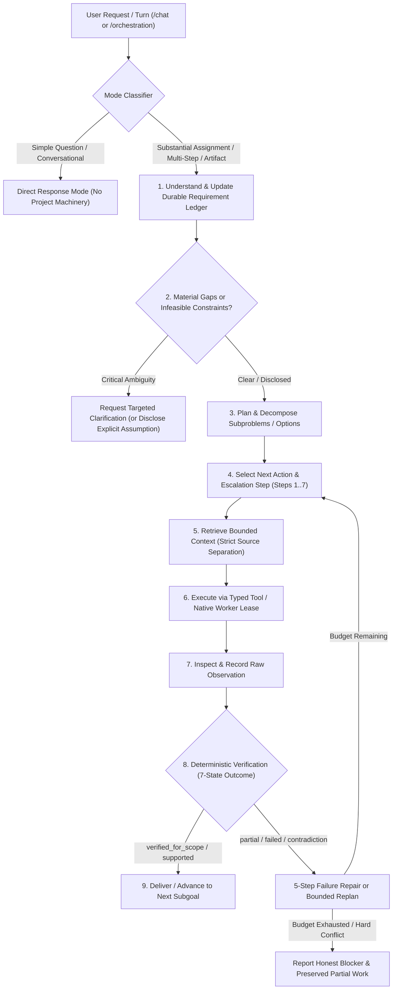

# Increment 18: Deliberate General-Purpose Assistant & Persisted Task-Solving Architecture

**Branch**: `feature/increment18-deliberate-task-solving-loop`  
**Status**: Implemented (Reversible Development / Review Branch)  
**Target Hardware Profile**: Constrained Local / Distributed Edge Hosts (~3.7 GiB to 4 GiB RAM per node, `qwen2.5:1.5b` and `qwen2.5:3b` via loopback Ollama)

---

## 1. Executive Summary & Capability Goal

Increment 18 transforms Qwen Collective from a set of specialized orchestration, research, and artifact subsystems into a coherent, deliberate, general-purpose assistant capable of:
1. **Understanding requests & preserving user intent** across multi-turn conversations, mid-flight requirement updates, ambiguity resolution, and scope changes.
2. **Researching unfamiliar subjects** using source-separated retrieval, claim-level verification, contradiction detection, and freshness/scope checks.
3. **Reasoning through complex problems** via explicit subproblem decomposition, exact `Decimal` calculation, alternative comparison against hard/soft constraints, and bounded adaptive escalation.
4. **Writing and testing software** against pinned, independent acceptance tests in isolated runners without exposing hidden test oracles to model prompts.
5. **Creating useful, provenance-bound artifacts** and **managing substantial projects over time** across interruptions, restarts, and requirement revisions.

Rather than assuming that small local models (`qwen2.5:1.5b`, `qwen2.5:3b`) behave like frontier models when given longer prompts or more agents, this architecture uses **persisted state**, **deterministic tools**, **strict source/instruction separation**, **bounded context assembly**, **independent verification**, and **measured role routing** to achieve dependable task completion with honest limits.

---

## 2. Current-State vs. Target-State Mapping

### 2.1 Current Request → Planning → Execution → Verification → Delivery Path (Before Increment 18)

| Path Stage | Implemented Module(s) | Connected to UI / API? | Test / Script Only? | Identified Gaps Addressed in Increment 18 |
| :--- | :--- | :--- | :--- | :--- |
| **Conversational Entry (`/chat`)** | `app/routes/chat.py`, `app/services/chat_context.py` | Yes (`/chat`, `/chat/send`) | No | Previously injected passive project markdown into a single chat completion (`max_tokens=2048`). Did not distinguish simple direct questions from durable project assignments, nor expose structured project progress, active step, blockers, or steering controls. |
| **Intake & Requirement Parsing** | `app/services/orchestration/intake.py`, `planner.py:analyze_intake` | Yes (via `/projects/{id}/orchestration/intake`) | No | `RequirementLedger` existed in memory during plan generation/evaluation (`RequirementKind`, `RequirementHardness`), but lacked a durable versioned table tracking user decisions/corrections, explicit assumptions, material missing information, requirement dependencies, verification methods/statuses, and selective artifact invalidation upon mid-flight steering. |
| **Planning & Task Graph** | `app/services/orchestration/planner.py`, `task_graph.py`, `contract.py` | Yes (`/orchestration/plan`) | No | Supported template & AI plans (`PLANNER_MAX_TOKENS=2048`), but lacked adaptive effort escalation, subproblem option matrices, and selective re-planning that preserves unaffected accepted work when constraints change mid-run. |
| **Context Assembly & Project Memory** | `app/services/orchestration/context_manager.py`, `knowledge_store.py` | Yes (used by `engine.py`) | No | **Defect fixed in Increment 18**: `_format_input_for_inference` and `build_inference_prompt` previously defaulted missing `verification_status` to `"supported"` (`c.get("verification_status") or "supported"`). Also lacked persistent structured project memory (`project_memory_state`) for candidate approaches, failed approaches, unresolved contradictions, and downstream invalidation. |
| **Execution & Native Task Leasing** | `app/services/orchestration/engine.py`, `model_router.py`, `vps_agent/executor.py` | Yes (`/api/worker/*`, `/orchestration/*`) | No | Prompt/token caps were uncoordinated across `planner.py` (2,048 tokens), `model_router.py` (8,000 chars), `context_manager.py` (5,200 chars), and `vps_agent/executor.py` (1,024 tokens / 10,000 chars). Role routing defaulted to `1.5b` even when `3b` was required for multi-constraint reasoning or structured JSON/code bundles. |
| **Financial & Claim Verification** | `app/services/orchestration/financial_ledger.py`, `app/services/research/financial_reasoning.py`, `claim_contracts.py` | Partial (used by research ledger) | Mostly exercised in targeted tests | Exact `Decimal` cent-level reconciliation and source-scope claim contracts existed, but were not wired into a general-purpose deliberate reasoning & option-comparison tool catalogue accessible to project runs. |
| **Software Proposal & Protected Verification** | `app/services/orchestration/code_proposals.py`, `protected_verification.py`, `code_sandbox.py` | Held behind explicit dev injection | Exercised in isolated tests | Provided append-only `software_review_items` and isolated test verification, but lacked a general-purpose iterative failure-repair cycle (`proposed -> observed -> verified_for_scope / failed`) with hidden oracle isolation. |

---

## 3. Unified Persisted Task-Solving Cycle

Increment 18 unifies conversational interaction and project orchestration around **one persisted task-solving cycle** without creating a competing agent loop or duplicate database:

### 3.1 Two Execution Modes
1. **Direct-Response Mode (`mode = "direct_response"`)**:
   - Triggered for self-contained questions, explanations, or lightweight calculations that require no durable deliverables, multi-stage research, or code/test execution.
   - Returns an immediate response without creating unnecessary projects, task graphs, or artifacts.
2. **Durable-Project Mode (`mode = "durable_project"`)**:
   - Triggered for substantial assignments involving multiple deliverables, external/document research, multi-constraint option comparisons, financial/data reconciliation, code generation with tests, or multi-turn project management.
   - Persists state across `orchestration_runs`, `project_requirement_items`, `project_requirement_revisions`, `project_memory_state`, `orchestration_tasks`, and `artifacts`.

---

## 4. Prompt, Context, and Output Budget Alignment

To prevent silent prompt clipping or truncated structured outputs across small local models (`4096`-token context window on 3.7–4.0 GiB RAM hosts), Increment 18 coordinates budgets across all layers:

| Component | Parameter | Previous Value | Coordinated Increment 18 Policy |
| :--- | :--- | :--- | :--- |
| `context_manager.py` | `DEFAULT_CONTEXT_CHARS` / `PER_INPUT_CHARS` | `5200` / `2400` | `5200` chars default (`2400` per input), expandable up to `6800` chars for multi-source synthesis while staying strictly below the `8000`-char router/worker ceiling. |
| `model_router.py` | `MAX_PROMPT_CHARS` | `8000` | `8000` chars hard cap; logs explicit `prompt_truncated` warning if caller exceeds budget instead of silently clipping critical instructions. |
| `planner.py` | `PLANNER_MAX_TOKENS` | `2048` | Coordinated with worker `MAX_NUM_PREDICT` (`2048` tokens max for structured plans/code bundles; `calculate_planner_token_budget` ensures prompt + generation fits within `4096` context window). |
| `vps_agent/executor.py` | `MAX_NUM_PREDICT` / `MAX_OUTPUT_CHARS` | `1024` / `10000` | `MAX_NUM_PREDICT` raised to `2048` (matching `PLANNER_MAX_TOKENS` so planner and multi-file code bundle generations are never silently clamped to 1,024 tokens by the worker); `MAX_OUTPUT_CHARS = 12000`. |
| `evaluator.py` | Truncation Detection | Partial (`output_not_truncated`) | Enforces explicit truncation checks for both prose (incomplete sentence/bullet at token cap) and JSON/code bundles (unbalanced braces/fences or `gen_tokens >= num_predict`). |

---

## 5. Seven-State Verification Model & Five-Step Failure Repair

Every requirement item and artifact version carries an explicit verification method and one of seven verification statuses:
1. `proposed`: Model or planner generated a candidate output or plan not yet checked.
2. `observed`: Raw tool or worker execution receipt recorded, but domain/acceptance checks not yet run.
3. `supported`: Factual claim or recommendation is backed by verified source snapshots and/or exact calculation derivations.
4. `verified_for_scope`: Deliverable passed all deterministic schema, execution, and goal checks for its declared scope.
5. `partial`: Some requirements or sub-deliverables passed and are preserved, while others remain incomplete or failed.
6. `blocked`: Execution cannot proceed due to an infeasible constraint conflict, missing external authority/resource, or exhausted budget.
7. `failed`: Output violated hard constraints, failed independent tests, or contained unsupported/contradicted claims.

When a step produces `failed` or `partial`, the deliberate loop executes a **5-step failure repair cycle** under fresh native task/lease execution:
1. **Classify Failure**: Distinguish syntax error, test failure, schema mismatch, missing evidence, arithmetic mismatch, constraint violation, or truncation.
2. **Isolate Root Cause**: Extract exact error diagnostics (e.g., failing test case name/assertion or violated constraint ID) **without exposing hidden test source code or private oracle answers** in the repair prompt.
3. **Preserve Unaffected Work**: Keep validated upstream artifacts, source snapshots, and unrelated completed deliverables intact.
4. **Formulate Targeted Repair Action**: Select the appropriate escalation step (e.g., tighten output schema, run `Decimal` calculator, switch from `qwen2.5:1.5b` to `qwen2.5:3b`, or narrow context).
5. **Re-Verify Independently**: Execute the repaired proposal through a fresh native task/lease and re-run independent verification checks.

---

## 6. Migration Path

1. **Schema Migration 20 (`app/migrations.py`)**: Adds `project_requirement_items`, `project_requirement_revisions`, `project_memory_state`, and `procedure_outcome_registry` without altering existing Increment 1–19 tables.
2. **Backward Compatibility**: All existing routes (`/projects`, `/tasks`, `/orchestration`, `/research`, `/artifacts`) and all 279 Increment 17 regression tests remain 100% compatible.
3. **Incremental Rollout**: The deliberate task-solving loop is accessible through `app/services/orchestration/deliberate_loop.py`, integrated with `/chat` (`app/routes/chat.py`) and `/projects/{id}/orchestration` (`app/routes/orchestration.py`), and evaluated against the 20 acceptance tasks in `COLLECTIVE_ACCEPTANCE_TASKS.json`.

