# Artifact Preview Internal Server Error — Root Cause Analysis

**Classification:** CONFIRMED DEFECT (deployment/runtime) — Severity **CRITICAL** (blocks every deliverable page)
**Audit date:** 2026-10-21 (local) / 2026-10-22 UTC
**Live controller:** Windows service `QwenCollective` (WinSW, LocalSystem), PID 19300, `127.0.0.1:8000`, proxied to the tailnet by `tailscale serve`

---

## 1. Summary

Every "Open / Preview" click returns **HTTP 500 Internal Server Error** because the live controller process is executing a **stale, pre-RC2 copy of `app/routes/deliverables.py`** that calls Starlette's removed legacy signature:

```python
templates.TemplateResponse("deliverables/detail.html", {"request": request, ...})
```

Under the installed Starlette 1.x, the first positional argument is `request`, so the template **name** receives the context **dict**. Jinja2's template cache then attempts `cache[dict]` and raises:

```
TypeError: unhashable type: 'dict'
```

The artifacts, storage, checksums, MIME handling, and the preview *data* generator are all working. The failure is purely in HTML page rendering, and it affects **both** pages in that router: the deliverable detail page and the Deliverables library index.

The source on disk (and the RC2 package) already contains the corrected keyword form. The service was simply **never restarted** after the fix:

| Fact | Evidence |
| :--- | :--- |
| Controller process start | `Started server process [19300]` at **2026-10-18 20:25:04** (service err log line 7398) |
| `deliverables.py` last modified on disk | **2026-10-21 00:48:32** |
| Traceback frame | `deliverables.py", line 142, in deliverable_detail` |
| Line 142 of the on-disk file | blank; on-disk `TemplateResponse` call is at line 183 |
| Line 142 of `git show HEAD:app/routes/deliverables.py` (commit `9bcd674`, 2026-10-18 17:21) | `return templates.TemplateResponse(` followed by `"deliverables/detail.html", {"request": request, ...}` |
| Legacy-signature calls in HEAD `deliverables.py` | **2** (detail + library). All other route modules: 0 |
| Legacy-signature calls in working tree / RC2 zip | **0** (RC2 `deliverables.py` is byte-identical to the working tree) |

---

## 2. Reproduction (real browser, live controller)

Script: `scratch/repro_preview.py` → evidence `preview_repro_results.json`, `preview_repro_trace.zip`, `screens_preview_repro/`.

1. Log in as admin at `/auth/login` (Playwright Chromium).
2. Open `/projects/prj-c3e69205a8e0466ab54b609801694796?tab=deliverables` (user's original project).
3. Click **Open / Preview** (`a[title='Open and Preview Deliverable']`).
4. Observed: `GET /deliverables/art-b9ab64a5bd614164` → **500**, body text `Internal Server Error`.

The same result was reproduced on a **fresh project** run during this audit (`prj-c74dd685…`, artifact `art-ea7a176ffa6f46c7`, 500).

### Per-artifact results (user's original project)

| Artifact | File | Detail page | JSON preview API | Download | Download SHA-256 = recorded |
| :--- | :--- | :--- | :--- | :--- | :--- |
| art-b9ab64a5bd614164 | research_report.md (7,021 B) | **500** | 200 (markdown, 7,011 chars) | 200 | ✅ `2f56c1e0…f005b` |
| art-956321c67c6848b5 | search_results.json | **500** | 200 (json) | 200 | ✅ |
| art-0c90faff75c04acb | retrieved_sources.json | **500** | 200 (json) | 200 | ✅ |
| art-dc40bafe3e5e4a01 | evidence_ledger.json | **500** | 200 (json) | 200 | ✅ |
| art-3d946ed5bf284d21 | citation_audit.json | **500** | 200 (json) | 200 | ✅ |
| art-984475af896147a6 | deliverables_index.json | **500** | 200 (json) | 200 | ✅ |
| — | `/deliverables` (library index) | **500** | — | — | — |

All six files exist on disk. Their on-disk SHA-256 values match the database records exactly.

Server-side: the count of `unhashable type` tracebacks rose from 4 (the user's clicks) to 12 after the reproduction (7 detail + 1 index). Tracebacks show `deliverable_detail` at line 142 and `deliverables_library` at line 80.

---

## 3. Complete path trace

```mermaid
flowchart LR
  A["Open / Preview link (no JS)"] --> B["GET /deliverables/{id}"]
  B --> C["get_current_user: OK"]
  C --> D["artifact_service.get_artifact: OK"]
  D --> E["get_preview_data -> resolve_download -> LocalFilesystemStorage._resolve_safe_path: OK, checksum OK"]
  E --> F["knowledge links + projects query: OK"]
  F --> G["templates.TemplateResponse(name_as_request, context_as_name)"]
  G --> H["jinja2 cache.get(dict) -> TypeError"]
  H --> I["Unhandled -> Starlette 500"]
```



| Question | Answer |
| :--- | :--- |
| Do all failed previews share one exception? | **Yes**: `TypeError: unhashable type: 'dict'` in `jinja2/utils.py:515`, raised from the legacy `TemplateResponse` call |
| Missing artifact fields? | No. `cas_hash` is NULL on all research artifacts (they use legacy `local_filesystem` absolute keys), but preview and download both resolve them correctly |
| Malformed content? | No. JSON parses, markdown decodes, and checksums match |
| Preview vs download different storage path? | No. Both use `resolve_download` |
| Obsolete endpoint? | No. The link targets an existing route |
| Recent regression? | Effectively yes. The route was written with the legacy signature in commit `9bcd674` and corrected in the uncommitted working tree, but the corrected code was never loaded |
| Errors caught usefully? | **No.** `deliverable_detail` has no exception handling, so a storage or permission error would also surface as a bare 500 |
| 500 masking a client error? | Not in this incident. Separately, `PermissionError`/`FileNotFoundError` from `resolve_download` would also become 500 rather than 403/404 |

---

## 4. Verification that RC2 code fixes it (isolated, disposable)

Script: `scratch/isolated_preview.py` → `isolated_preview_results.json`, `screens_isolated_preview/`.

This test used a disposable controller on port 64331, a temporary data directory, and the working-tree code (byte-identical to RC2). The fixtures are synthetic and labeled `SYNTHETIC PREVIEW FIXTURE`.

| Fixture | Detail page | Visible rendered content | Script executed | Download SHA match |
| :--- | :--- | :--- | :--- | :--- |
| .md | 200 | ✅ Markdown mode, text visible | — | ✅ |
| .txt | 200 | ✅ | — | ✅ |
| .csv | 200 | ✅ table rows | — | ✅ |
| .json | 200 | ✅ pretty-printed | — | ✅ |
| .pdf | 200 | ✅ "Open PDF in Browser Viewer" | — | ✅ |
| .html (with `<script>`) | 200 | ✅ shown as escaped source | **No** | ✅ (served as attachment) |
| .svg (with `<script>`) | 200 | ✅ shown as escaped source | **No** | ✅ |

The HTML and SVG results are expected behavior: active content is deliberately shown as source rather than rendered.

> [!WARNING]
> The same isolated run showed that **RC2 code serves artifact metadata, preview JSON, full downloads, and the artifact list to unauthenticated clients** (HTTP 200 with no session). The live service does the same, and it is exposed to every tailnet device via `tailscale serve`. This is a separate high-severity defect, recorded as F-04 in the fix plan.

---

## 5. Smallest safe correction

**Operational (no code change):** restart the `QwenCollective` service so it loads the already-corrected working-tree / RC2 code. This needs operator authorization, because live-service restarts were explicitly out of scope for this audit and were **not performed**.

Caveat: a restart loads *all* uncommitted working-tree changes, about 40 modified files including migrations-adjacent code. The operator should treat this as a deployment of the RC2 code base, not as a single-file hotfix.

**Code hardening (separate approval):**
1. Wrap `get_preview_data` in `deliverable_detail`. Map `FileNotFoundError` to 404 and `PermissionError` to 403. Map integrity `ValueError` to 409, and render the page with a visible "preview unavailable: <reason>" panel instead of a bare 500.
2. Add a startup self-check that renders each registered template route once against a fixture, or add a CI lint that rejects `TemplateResponse("` string-first calls.
3. Add a `/health` field exposing the loaded git revision and process start time, so stale-process drift is visible. The live service currently returns 404 for `/health`.

## 6. Regression tests required

| Test | Fails before | Passes after |
| :--- | :--- | :--- |
| `test_deliverable_detail_renders_200_for_md_json_csv_txt_pdf` via real `uvicorn` + HTTP (not TestClient) | Live: 500 | 200 with visible content |
| `test_deliverables_library_renders_200` | 500 | 200 |
| `test_no_legacy_templateresponse_signature` (AST scan of `app/routes`) | HEAD: 2 hits | 0 |
| `test_preview_missing_file_returns_404_page` | 500 | 404 page with message |
| `test_running_revision_matches_deployed_revision` (health endpoint) | n/a | revision equals package manifest |
