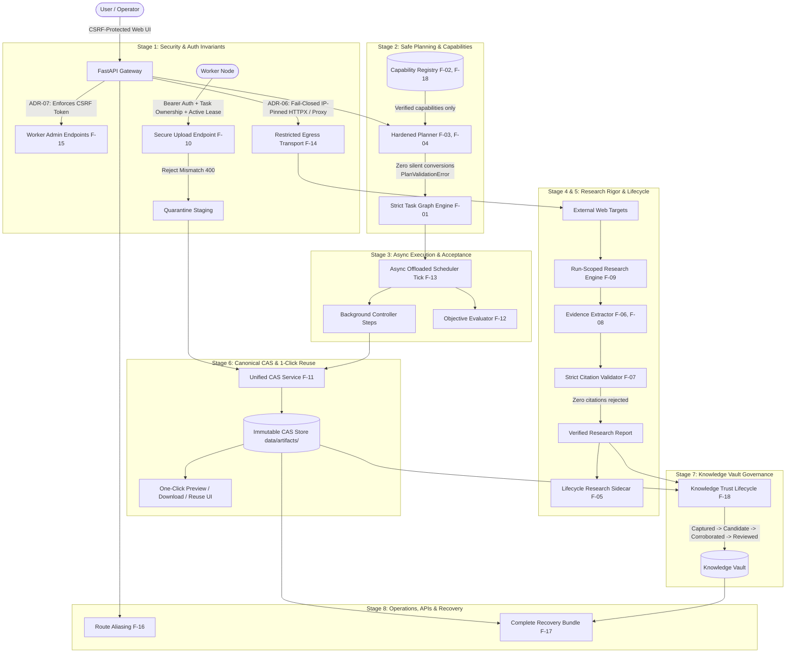

# Stage 00 — Reconnaissance, Verification, Safety Baseline & Target Architecture

**Date:** 2026-10-18  
**Active Branch:** `feature/unified-artifact-deliverables`  
**Before SHA:** `c98510b`  
**After SHA:** `c98510b` (No functional application code modified; control plane and baseline documentation established)  
**Environment:** Windows 10 Pro (Build 19045.5011 / 22H2 / AMD64), Python 3.12.10 (.venv), SQLite 3.49.1, FastAPI 0.143.0, Pydantic 2.14.1, Uvicorn 0.54.0, Pytest 9.1.1  
**Status:** **READY_FOR_REVIEW**  

---

## 1. Scope and Covered Audit IDs

Stage 0 encompasses an exhaustive architectural audit, code verification, test baseline capture, risk assessment, and target design formulation across all 18 findings:
- **F-01 through F-04, F-18:** Orchestration planning, silent action conversion, capability hallucination, prompt fidelity, and model routing.
- **F-06 through F-09:** Research evidence extraction, citation enforcement invariants, domain parsing, and cross-run scope bleeding.
- **F-05:** Monolithic research pipeline assumption and continuous project lifecycle research.
- **F-10, F-14, F-15:** Execution security, worker upload authorization & integrity, SSRF/DNS rebinding, and administrative CSRF.
- **F-11, F-12, F-13:** Content-Addressed Storage (CAS) unification, deliverable evaluation rigor, and scheduler concurrency.
- **F-16, F-17:** API route specification drift, disaster recovery runbooks, and CAS vault backup.

In accordance with Stage 0 constraints, **no functional application code was altered**. All work focused on static code inspection, live local test execution, establishing the control plane in `docs/remediation/`, and defining architecture blueprints.

---

## 2. Observed Baseline: What Actually Existed Before Changes

The active working tree represents commit `c98510b` on branch `feature/unified-artifact-deliverables`. Key architectural findings observed in the codebase:

1. **Dual Task Models:** The system maintains both a legacy `tasks` table (queried by older worker endpoints) and an `orchestration_tasks` table (driven by the DAG scheduler).
2. **Dual Artifact Storage Stores:** `app/services/artifacts/manager.py` implements a Content-Addressed Storage (CAS) mechanism storing blobs under `data/artifacts/xx/hash`. However, `app/services/orchestration/artifact_manager.py` completely bypasses this CAS system and writes mutable files to `evidence/orch_{run_id}/{name}`, permitting overwrites.
3. **Silent Fallback Repairs in Task Graph:** When a plan contains unknown actions or scripts, `task_graph.py` automatically rewrites `library_script` to `inference` and unknown controller steps to `assemble_report`. Cycles are pruned by dropping edges without human notification.
4. **Keyword Interception of Planning:** Prompts containing keywords like "research" or "study" are intercepted by regex in `planner.py` and forced into a 4-step research report pipeline, disregarding non-report deliverables.
5. **Worker Upload Vulnerability (F-10 Reconciled):** `POST /api/v1/worker/tasks/{task_id}/artifacts` requires valid worker token authentication (`Depends(get_authenticated_worker)`). However, it lacks task authorization and lease fencing (any valid worker can upload to any other worker's task or expired lease), only logs a warning on SHA-256 hash mismatch while returning HTTP 200, and writes mutable bytes directly to `evidence/task_{task_id}/{filename}`, overwriting existing files.
6. **Crawler SSRF / DNS Rebinding:** Preflight DNS checks in `app/services/research/retrieval.py` inspect IP addresses, but the subsequent HTTP client socket connects by hostname, allowing time-of-check to time-of-use DNS rebinding.
7. **Missing Admin CSRF:** State-modifying worker administration endpoints rely on cookies without CSRF validation.

---

## 3. Host Operating System Audit

- **Operating System:** Microsoft Windows 10 Pro 64-bit (10.0.19045.0 / 22H2).
- **Support Lifecycle:** Official Microsoft support for Windows 10 Version 22H2 ended on **October 14, 2025**. The local environment date is **October 18, 2026** (~1 year post-EOS).
- **Extended Security Updates (ESU):** Unconfirmed without administrative licensing queries.
- **Environment Classification:** Current machine is the local development workstation and host controller.
- **Operational Risk & Migration Plan:** Running an unpatched host controller in production poses operational risks (RSK-13). A migration plan to a supported OS (Windows 11 Enterprise, Windows Server 2022/2025, or Ubuntu 24.04 LTS) must be executed before production cluster deployment.

---

## 4. Test Suite Baseline Execution (55 Modules)

- **Exact Pytest Invocation:** `.venv/Scripts/python.exe -m pytest tests -q`
- **Output:** 462 collected, 460 passed, 2 failed, 9 warnings in 173.31s.
- **Sanitized Evidence:** [`docs/remediation/evidence/pytest_baseline_output.txt`](file:///C:/Users/Matt%20C/.gemini/antigravity-ide/scratch/qwen-collective/docs/remediation/evidence/pytest_baseline_output.txt)
- **Preexisting Failures:**
  1. `tests/test_orchestrator_units.py::test_extract_json_object_handles_prose_and_fences`: Unit test passes generic payload `{"plan": True}`, but `extract_json_object` filters for planning keys (`overview`, `objective`, etc.). Fixed in Stage 2 by parameterizing key filters.
  2. `tests/test_web_routes.py::test_knowledge_page`: Test asserts `"Persistent Knowledge Repository"`, but template was updated to `"Collective Knowledge & Evidence Repository"`. Reconciled in Stage 8.

---

## 5. Architecture Diagrams

### Target Architecture (Canonical 9-Stage Invariant Enforcement)



---

## 6. Recommended Go/No-Go Decision

**Recommendation:** **GO FOR STAGE 1**
- **Rationale:** All 18 findings verified. Baseline test suite (460 pass, 2 fail across 55 modules) fully documented. Empirical proof of worker upload flaws captured in isolated test. Host OS audit completed. Governance control plane synchronized with canonical 9-stage master roadmap.
- Critical security vulnerabilities (F-10, F-14, F-15) are prioritized for immediate remediation in Stage 1.

---

## 7. Next Stage & Continuation Command

To authorize progression to **Stage 1 (Security and Authorization Trust Boundaries)**, respond with:

```text
CONTINUE STAGE 1
```
